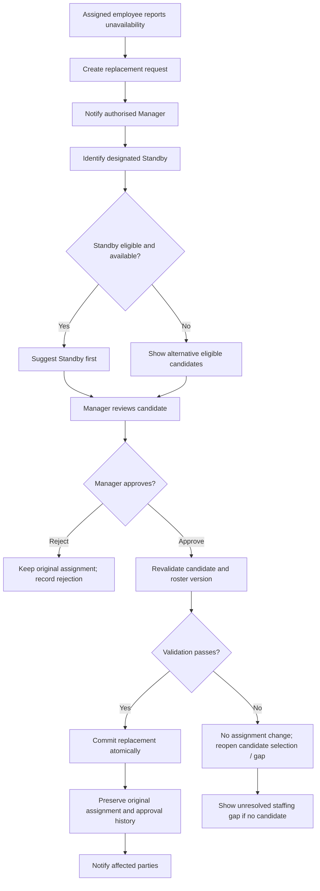

# 03_ROLES_PERMISSIONS_AND_WORKFLOWS
## Holiday Support Roster Management System

| Field | Value |
|---|---|
| Document ID | ROSTER-SEC-WF-003 |
| Version | 2.3 — Finalized under reconciliation authority |
| Date | 27 November 2026 |
| Status | Finalized implementation baseline under authorized reconciliation |
| Governing PRD | `Roster_Corrected_Final_PRD_v5.md`, v5.4 |
| Domain source | `02_DOMAIN_AND_BUSINESS_RULES.md`, v2.3 |
| Decision authority | `ROSTER_CONFIRMED_BUSINESS_DECISIONS.md` v1.1, Part F |
| Architecture | Modular monolith; backend authorization required |

## Revision history

| Version | Date | Change |
|---|---|---|
| 1.0 | 26 Nov 2026 | Source-aligned role and workflow specification |
| 2.0 | 26 Nov 2026 | Adds Manager-approved one-way replacement, manual assignment, global duty visibility and revised workload semantics |
| 2.1 | 27 Nov 2026 | Validated against authoritative decision register `ROSTER-PO-DECISIONS-001`; no role or workflow rule change required. |
| 2.2 | 27 Nov 2026 | Finalized scoped approval authority/recusal, immediate availability, account lifecycle and revision separation; excluded completion, acknowledgment and mutual swap workflows. |
| 2.3 | 27 Nov 2026 | Closed historical authorization/open workflow language; updated handover state and final decision outcomes. |

## 1. Purpose and authorization principles

This document defines application roles, permissions, data scopes, approval boundaries and user workflows. It does not silently add a fourth application role.

Authorization is the combination of:
1. authenticated account;
2. effective-dated application role;
3. explicit permission;
4. resource scope;
5. relationship to the affected employee/team/assignment/request;
6. current resource state and domain validation.

Every sensitive operation is enforced server-side. Frontend menu visibility is not authorization.

The active authority rules are Decision Register v1.1 FDR-03/FDR-05/FDR-09. Any historical text in this document describing Manager role mapping, availability approval, or closed-period revision as open is superseded by the final rules below and in the register.

### 1.1 Role baseline

The source PRD defines exactly three application roles:

| Role | Description |
|---|---|
| Admin | Organisation-wide configuration and operational administration, within explicit permissions |
| Team Lead (TL) | Team-scoped operational responsibilities |
| Member / Employee | Self-service and named workflow participation |

**Manager approval authority is a separate scoped capability, not a fourth application role.** An Admin with `ORG.AUTHORITY.MANAGE` may grant a named account `REPLACEMENT.APPROVE` for an explicit team/organization scope and time interval. No Admin or TL has it by default; grantor cannot self-grant. Requester, affected assignee and proposed candidates are recused. Delegation requires a separate explicit grant. If no unconflicted approver is available, the request remains pending and is escalated; assignment does not change.

## 2. Scope definitions

| Scope | Meaning |
|---|---|
| OWN | Current user's own employee/account/availability/assignment records |
| TEAM | Team(s) explicitly assigned to the current TL/acting TL for the effective period |
| ORG | Organisation-wide records and reporting |
| ASSIGNED | Requests/approvals explicitly assigned to the current actor |
| PARTICIPANT | A request in which the current user is requester, target, affected assignee or replacement candidate |
| HELP_ROLE | Published help content visible to the user's application role |

Membership does not itself confer access. One active team membership per employee/date and at most one active Team Lead per team/date; both are effective-dated.

## 3. Role responsibilities

### 3.1 Admin
- Maintain organisation settings, employees, teams, effective-dated roles and calendar configuration.
- Configure holiday requirements where explicitly authorised.
- Generate/review/publish rosters under the approved permission model.
- Perform organisation-wide duty reporting and audit review.
- Administer Help Centre content.
- Receive escalation for unresolved gaps and operational failures.
- Does not automatically receive Manager replacement-approval authority.

### 3.2 Team Lead
- View permitted team roster and team-level workload context.
- Coordinate availability and team operational workflows where authorised.
- Receive notifications for team-relevant matters.
- Participate in replacement candidate discovery or request handling only if granted explicit permission.
- Cannot approve a replacement merely by virtue of being TL.
- Cannot modify organisation-wide configuration or access unrelated team data.

### 3.3 Member / Employee
- Complete first-login onboarding.
- Maintain own availability/unavailability.
- View own assignments and permitted roster information.
- Report unavailability against an existing assignment.
- Participate in replacement workflow as requester or candidate.
- View permitted duty history.
- Submit operational handover information if enabled.
- Cannot approve own replacement request or alter the effective assignment.

### 3.4 Manager approver
This is an approval responsibility, not an application role. A named account has an explicit, time-bounded and scoped `REPLACEMENT.APPROVE` grant administered through `ORG.AUTHORITY.MANAGE`. No role receives it by default. Grantor cannot self-grant; requester, affected assignee and proposed candidates are recused. A delegate requires a separate grant. No eligible approver leaves the request pending and escalates without changing assignment.

## 4. Permission catalogue

Permission codes below are logical identifiers. They are not implementation-ready grants until role mapping and scopes are approved.

| Permission | Action | Default scope | Role boundary / note |
|---|---|---|---|
| ORG.USER.READ | Read employee directory | TEAM / ORG | Scope constrained |
| ORG.USER.MANAGE | Create/update/deactivate employee | ORG | Admin |
| ORG.TEAM.MANAGE | Manage teams | ORG | Admin |
| ORG.MEMBERSHIP.MANAGE | Manage effective-dated membership | ORG | Admin |
| ORG.ROLE.MANAGE | Assign application roles | ORG | Admin |
| ORG.AUTHORITY.MANAGE | Create/revoke scoped replacement approval grants | ORG | Admin explicitly granted; grantor cannot self-grant |
| CALENDAR.READ | Read calendar | TEAM / ORG | Scope constrained |
| CALENDAR.MANAGE | Manage holiday/calendar | ORG | Admin |
| HOLIDAY.REQUIREMENT.MANAGE | Configure Primary/Standby counts | ORG | Authorized configuration operator; exact role open |
| AVAILABILITY.READ | Read availability | OWN / TEAM / ORG | Privacy-filtered |
| AVAILABILITY.MANAGE_OWN | Submit own availability/unavailability | OWN | Member/TL/Admin as applicable |
| AVAILABILITY.MANAGE_ON_BEHALF | Submit on behalf | TEAM / ORG | Explicit grant; audit required |
| ROSTER.GENERATE | Generate draft roster | ORG | Explicitly authorized operator |
| ROSTER.READ | Read roster | OWN / TEAM / ORG | Scope constrained |
| ROSTER.MANUAL_ASSIGN | Add/change draft assignment | ORG | Explicitly authorized operator |
| ROSTER.FAIRNESS_OVERRIDE | Override soft fairness preference | ORG | Reason + audit; cannot bypass hard rules |
| ROSTER.PUBLISH | Publish reviewed roster | ORG | Explicit publish authority |
| ROSTER.REVISE | Create new revision | ORG | Published version immutable |
| ACCOUNT.INVITE | Invite linked employee account | ORG | Admin; single-use activation token |
| ACCOUNT.STATUS.MANAGE | Activate/deactivate account | ORG | Admin; deactivation revokes sessions |
| ACCOUNT.PASSWORD.SELF | Change own password / use recovery | OWN | Authenticated user or single-use reset token |
| REPLACEMENT.REQUEST_OWN | Report own assignment unavailability | OWN | Member |
| REPLACEMENT.READ | Read replacement request | PARTICIPANT / ASSIGNED / ORG | Scope constrained |
| REPLACEMENT.SELECT_CANDIDATE | Select alternative candidate | ASSIGNED / ORG | Manager authority or separately delegated operator; open |
| REPLACEMENT.APPROVE | Approve replacement | ASSIGNED / ORG | Manager approval grant mandatory |
| REPLACEMENT.REJECT | Reject replacement | ASSIGNED / ORG | Manager approval grant mandatory |
| STANDBY.ACTIVATE | Activate standby | ASSIGNED / ORG | Explicit operational authority; activation policy open |
| DUTY.REPORT.READ | Read effective published Primary credit/report | ORG | Scoped read; no completion or actual-performer history |
| HANDOVER.CREATE | Create handover | OWN / ASSIGNED | Author's duty |
| HANDOVER.READ | Read handover | ASSIGNED / TEAM | Visibility policy open |
| AUDIT.READ | Read audit events | ORG | Admin and explicitly authorised auditors |
| HELP.READ | Read published help | HELP_ROLE | All roles |
| HELP.MANAGE | Manage help content | ORG | Admin by source baseline |
| NOTIFICATION.READ | Read own notification | OWN | All roles |
| NOTIFICATION.OPERATE | Retry/inspect failed delivery | ORG | Admin/operations grant |

## 5. Permission matrix

Legend: A = allowed by source baseline; C = conditional on explicit grant/scope; M = mandatory approval capability not yet mapped; — = not allowed by default.

| Capability | Admin | Team Lead | Member |
|---|---:|---:|---:|
| Manage organisation/users/teams | A | — | — |
| Configure holidays | A | — | — |
| Configure per-holiday staffing | C | C | — |
| Read organisation roster | A | C | — |
| Read own assignments | A | A | A |
| Submit own availability | A | A | A |
| Submit availability on behalf | C | C | — |
| Generate roster | C | C | — |
| Manual draft assignment | C | C | — |
| Fairness override | C | C | — |
| Publish roster | C | — | — |
| Report own unavailability | A | A | A |
| Request replacement | A | A | A |
| Select alternative replacement | C | C | — |
| Approve/reject replacement | M — not automatic | M — not automatic | — |
| Activate Standby | C | C | — |
| Read org-wide duty history | C | — | — |
| Read team duty history | A | C | — |
| Read own duty history | A | A | A |
| Submit handover | C | C | C |
| Manage Help Centre | A | — | — |
| Read published help | A | A | A |
| Read audit | C | — | — |

**Important:** Manager approval cannot be mapped to all Admins by default. This table intentionally shows the mandatory capability as unmapped until OD-01/OD-16 is approved.

## 6. Resource-level access rules

- A Member can access own availability and own assignment details.
- A Member may access a replacement request in which they are a participant.
- A TL can access only assigned team scope or explicitly assigned request scope.
- An Admin may access organisation-wide operational data for authorised administrative purposes.
- Duty history is organization-wide for Managers as required; who else can see it is a Product Owner decision.
- Private availability notes and sensitive employee data require field-level filtering.
- Audit access is restricted and itself audited.
- Direct URL access must perform the same backend authorization as navigation.
- Exports require explicit permission, scope filtering and audit.
- No role can bypass hard eligibility, availability or duplicate-assignment constraints.

## 7. Approval and separation-of-duties rules

1. Replacement requires a Manager approval decision.
2. The requester's unavailability report does not approve the replacement.
3. The candidate selector may propose a candidate but cannot make the assignment effective.
4. Only an actor with explicit Manager approval authority may approve or reject.
5. The approver must be recorded with the decision, timestamp and reason.
6. The system revalidates candidate eligibility and availability at commit time.
7. If rejected, original assignment remains effective.
8. If no candidate exists, preserve the assignment, retain pending state, and notify/escalate the staffing gap.
9. Self-approval and approver conflict rules require OD-01; until decided, the system should fail closed and prohibit requester/candidate from approving their own replacement (PROPOSED, NOT APPROVED).
10. No Admin is presumed to be a Manager, and no TL is presumed to be a Manager.

## 8. User journeys

### 8.1 Admin journey
1. Sign in and complete Admin onboarding.
2. Review organisation, employees, teams and effective-dated access.
3. Configure holiday calendar and support requirements if authorised.
4. Generate draft roster.
5. Review feasibility, fairness explanation and staffing gaps.
6. Make permitted manual changes with validation and reason.
7. Review and publish using explicit publication permission.
8. Monitor notifications, replacement requests, unresolved gaps and audit.
9. Review organisation-wide duty reporting and Help Centre health.

### 8.2 Manager journey
1. Open assigned replacement request notification.
2. Review original assignment, reason, holiday, slot and validation status.
3. Review designated Standby candidate first.
4. If Standby is eligible and available, approve that replacement or choose another eligible candidate.
5. Re-run final validation.
6. Approve or reject with decision reason.
7. If approved, assignment changes atomically and notifications/audit are created.
8. If rejected or no valid candidate exists, original assignment remains and the gap remains visible.
9. Manager role mapping is not presumed; the user must possess the approved Manager authority grant.

### 8.3 Team Lead journey
1. Sign in and view permitted team calendar and roster.
2. Review team availability and relevant staffing gaps.
3. Assist with candidate identification if authorised.
4. Escalate replacement request to Manager approver.
5. Cannot approve replacement solely because the user is TL.
6. Review team duty information within approved scope.

### 8.4 Employee journey
1. First login, change temporary password and complete onboarding.
2. Maintain own availability.
3. View own future assignments.
4. If unable to perform an assigned holiday, report unavailability against that assignment.
5. Review request status and respond to permitted follow-up.
6. Participate as replacement candidate if selected.
7. View own duty history and submit handover information where enabled.

## 9. End-to-end workflows

### WF-01 First-login onboarding
`ACCOUNT_CREATED -> INVITATION/RESET -> FIRST_LOGIN -> PASSWORD_CHANGE -> ROLE_GUIDE -> CHECKLIST -> ACTIVE_USE`.
Progress is resumable. Urgent operational actions must not be blocked by a walkthrough.

### WF-02 Availability submission
`DRAFT -> SUBMITTED -> EFFECTIVE`. Submission/update is immediately effective for future generation and draft validation; it never changes a published assignment. Assignment conflicts use the replacement workflow.

### WF-03 Report unavailability against assignment
`ASSIGNED_EMPLOYEE_REPORTS -> VALIDATE_ASSIGNMENT -> CREATE_REPLACEMENT_REQUEST -> NOTIFY_MANAGER`.
The assignment remains unchanged.

### WF-04 Replacement candidate discovery
1. Load designated Standby for the affected holiday/slot.
2. Check active employment, eligibility, availability, duplicate holiday assignment and relevant roster version.
3. Suggest Standby first only if all checks pass.
4. If not, identify other eligible/available candidates.
5. If none, mark unresolved staffing gap and notify operational owner.

### WF-05 Manager-approved replacement

Workflow requirements:
- Requester: assigned employee, or another explicitly authorised reporter where approved.
- Recipient: designated Manager approver; operational escalation recipients may be notified but do not gain approval rights.
- Approver: only an actor with explicit Manager approval grant.
- Alternative selection: Manager may select another eligible/available employee; any delegated selector must be explicitly approved.
- Validation: employment, rotation eligibility, availability, duplicate-per-holiday, slot type, assignment version, roster state and any approved policy constraints.
- Effective time: only after Manager approval and successful transaction-time validation.
- No candidate: no mutation; visible unresolved staffing gap.
- Audit: requester, approver, decision, timestamp, reason, original employee, replacement employee, holiday/slot, validation result, version and notification outcome.

### WF-06 Replacement rejection
`AWAITING_MANAGER_DECISION -> REJECTED`; original assignment remains effective. Record decision reason and timestamp. Request remains visible in history; staffing issue may remain unresolved.

### WF-07 Manual assignment
1. Authorised operator selects a draft slot and employee.
2. Backend validates eligibility and availability.
3. Backend checks duplicate-per-holiday and roster version.
4. If valid, save assignment with origin `MANUAL`.
5. If fairness preference is overridden, require explicit permission, warning, reason and audit.
6. Hard constraints cannot be overridden.

### WF-08 Automatic generation and review
1. Freeze generation inputs.
2. Process holidays chronologically.
3. Update temporary projected workload.
4. Evaluate combinations and same-team preference.
5. Validate whole-roster global fairness.
6. Backtrack/reassign where necessary.
7. Persist a draft version and explanation.
8. Human reviewer inspects gaps and decisions.

### WF-09 Publication
`DRAFT -> REVIEWED -> PUBLISHED`; publication requires authorization and final validation. Published versions are immutable. Later changes require a new revision.

### WF-10 Standby activation
1. Identify designated Standby.
2. Validate eligibility and availability.
3. Record activation actor/time/reason.
4. Link Standby to the Primary duty being covered.
5. Official workload attribution follows the effective published Primary assignment; replacement transfers its slot credit. No actual completion/performance is collected.
6. Preserve original Primary assignment and activation history.
7. Activation authority and emergency policy remain subject to decision.

### WF-11 Duty history and reporting
Authorized scoped readers can view effective published Primary credits, future assignments, Standby assignments/activations, drafts, replaced and cancelled history as separate dimensions. No aggregate may imply actual performance or combine distinct dimensions without labels.

### WF-12 Handover
Author creates an assignment-linked operational handover report; no mandatory receiver or acknowledgement exists. Submitted report is immutable; correction uses a linked addendum retained with roster/audit history, without automatic deletion unless customer policy requires it.

### WF-13 Help Centre administration
Admin creates/edits/drafts/publishes/archives role-visible content. Published versions are retained. Draft content is not searchable by ordinary users.

### WF-14 Notifications
Create notification intent for request, decision, replacement, staffing gap, publication and relevant duty events. Delivery failure is tracked and retried; business transaction remains committed.

### WF-15 Audit review
Authorised reviewer filters append-only events by actor, action, resource and date. Viewing/exporting audit data is itself logged.

## 10. State and transition matrix

| Resource | State | Allowed next state | Guard |
|---|---|---|---|
| Replacement request | SUBMITTED | AWAITING_MANAGER_DECISION | Request valid |
| Replacement request | AWAITING_MANAGER_DECISION | APPROVED | Manager authority + final validation |
| Replacement request | AWAITING_MANAGER_DECISION | REJECTED | Manager authority + reason |
| Replacement request | AWAITING_MANAGER_DECISION | UNRESOLVED_GAP | No eligible candidate |
| Roster version | DRAFT | REVIEWED | Review validation |
| Roster version | REVIEWED | PUBLISHED | Publish permission + final validation |
| Standby | DESIGNATED | ACTIVATED | Activation authority + eligible/available |
| Handover | DRAFT | SUBMITTED | Author permission and valid report |
| Handover | SUBMITTED | ARCHIVED | Submitted reports are immutable; addenda link to prior reports; no acknowledgement state |

## 11. Notifications

| Event | Recipient | Required content |
|---|---|---|
| Replacement request created | Manager approver | Original assignee, holiday, slot, reason, candidate/Standby status |
| Replacement approved | Original and replacement employees; operational stakeholders | Decision, effective assignment and timestamp |
| Replacement rejected | Requester and operational owner | Decision and reason |
| No eligible replacement | Manager and designated operational escalation | Staffing gap and affected holiday |
| Standby replacement approved | Standby, original assignee and operational owner | Assignment change and effective replacement |
| Roster published | Affected assignees | Published version and assignments |
| Critical delivery failure | Admin/operations | Event, attempts and recovery status |

## 12. Audit requirements

At minimum retain:
- actor identity and effective authority;
- request ID and correlation ID;
- original and replacement employee;
- decision, reason and timestamp;
- validation result and roster version;
- assignment origin (automatic/manual);
- prior and new assignment references;
- Standby designation and activation;
- publication/revision event;
- notification intent and delivery status.

Audit records are append-only from application workflows. Corrections are new events, not destructive edits.

## 13. Historical open-decision register (superseded by v2.2)

| ID | Decision | Why it matters | Blocks |
|---|---|---|---|
| OD-01/16 | Resolved by FDR-03: three roles, scoped/time-bound grant, recusal, no self-grant | Customer provisions actual approver grants | Setup only |
| OD-03 | Resolved by FDR-05: immediate availability; published assignment protected | None | No |
| OD-05 | Resolved by FDR-07: one active team/member and one active lead/team | Customer supplies actual org data | Setup only |
| OD-07 | Mutual swaps excluded | None | Out of initial release |
| OD-08 | Duty completion excluded by FDR-01 | None | Out of initial release |
| OD-09 | Acknowledgment excluded; linked addenda retained by FDR-08 | Customer retention policy may set later | No |
| OD-10 | Resolved by FDR-09: reasoned immutable child version with two-person publication | None | No |

This table is retained for traceability; no initial-release Product Owner policy decision remains open.
