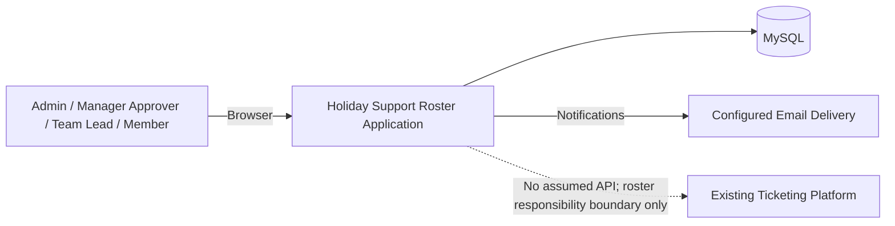
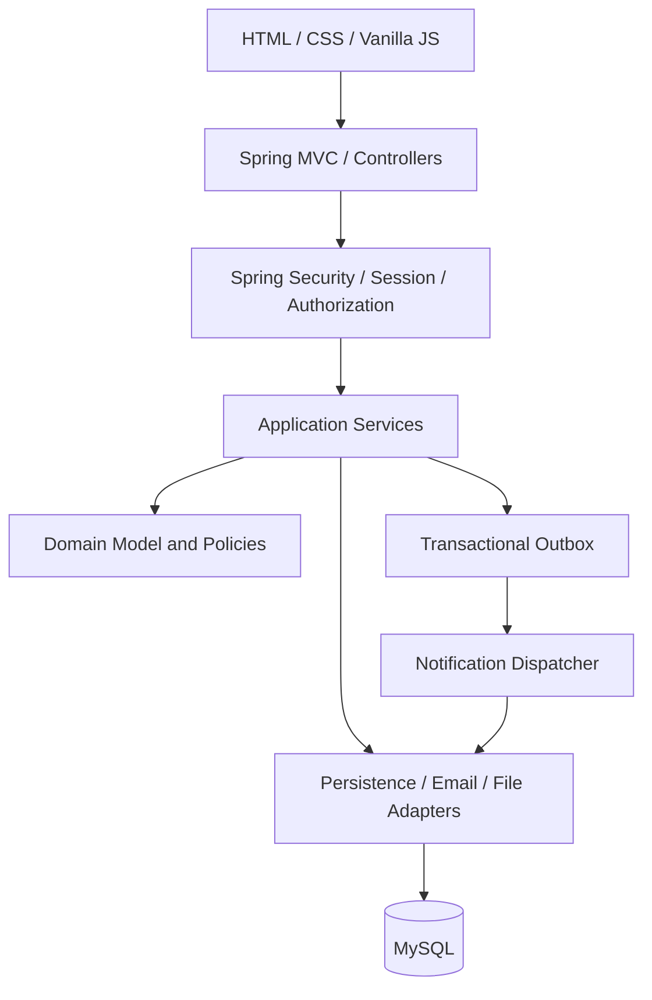

# 04_SYSTEM_ARCHITECTURE
## Holiday Support Roster Management System

| Field | Value |
|---|---|
| Document ID | ROSTER-ARCH-001 |
| Version | 2.4 — Finalized under reconciliation authority |
| Date | 27 November 2026 |
| Status | Finalized implementation baseline; runtime setup remains external |
| Governing PRD | `Roster_Corrected_Final_PRD_v5.md`, v5.4 |
| Domain | `02_DOMAIN_AND_BUSINESS_RULES.md`, v2.3 |
| Roles & Workflows | `03_ROLES_PERMISSIONS_AND_WORKFLOWS.md`, v2.3 |
| Frontend | HTML5, CSS3, Vanilla JavaScript ES6+ and ES Modules |
| Backend | Java, Spring Boot, Spring Security, Spring Data JPA, Hibernate, Jakarta Validation, Spring Mail where appropriate |
| Database | MySQL |
| Architecture | Single-deployable modular monolith |

## Revision history

| Version | Date | Change |
|---|---|---|
| 1.0 | 26 Nov 2026 | Original modular monolith architecture proposal |
| 2.0 | 26 Nov 2026 | Reconciles allocation, replacement approval, workload, standby and scope requirements |
| 2.1 | 27 Nov 2026 | Incorporated authoritative decision register and confirmed v0/Replit/Antigravity workflow; added ARC-01 rather than silently changing the frontend framework. |
| 2.2 | 27 Nov 2026 | Superseded v0/Replit workflow and ARC-01; assigned Antigravity to approved Vanilla-JS frontend development and Codex to approved Java/Spring Boot backend development. |
| 2.3 | 27 Nov 2026 | Finalized workload, auth, revision, migration, notification and handoff policies under authorized reconciliation. |
| 2.4 | 27 Nov 2026 | Added exact FDR-02 comparator and removed stale fairness/completion blockers from the active architecture. |

## 1. Executive summary

Implement one deployable Spring Boot modular monolith with a same-origin HTML5/CSS3/Vanilla JavaScript ES-module frontend and one MySQL database. Antigravity and Codex are development tools, not architecture decisions. Use layered architecture within explicit business-capability modules. Keep the scheduling engine pure and independently testable. Enforce permissions and workflow rules on the server. Use transaction-time validation, optimistic concurrency and database constraints to protect roster integrity. Use immutable published roster versions and a transactional outbox for reliable notifications.

This architecture does not create a database schema, SQL DDL, JPA entity code, repositories, API contracts or implementation code.

## 2. Technology constraints

| Layer | Approved technology | Prohibited alternatives |
|---|---|---|
| Frontend | HTML5, CSS3, Vanilla JavaScript ES6+, ES Modules | React, Next.js, TypeScript, Angular and Vue remain prohibited without a formal approved architecture change |
| Backend | Java, Spring Boot | Node.js backend, Python backend, PHP |
| Security | Spring Security | Unapproved identity platform |
| Persistence | Spring Data JPA, Hibernate | Alternative ORM without approval |
| Validation | Jakarta Validation | Client-only validation |
| Database | MySQL | MongoDB or another database |
| Email | Spring Mail where appropriate | Unapproved notification provider assumptions |
| Architecture | Modular monolith | Microservices or distributed internal services |

## 3. Architectural principles

- Modular monolith, one deployable runtime.
- Layered architecture: presentation, application, domain and infrastructure.
- Clear module ownership and dependency direction.
- SOLID and separation of concerns without unnecessary abstraction.
- Domain rules independent of Spring/JPA/browser frameworks.
- Server-side authorization on every protected operation.
- Transactional business operations and immutable history.
- Deterministic, explainable allocation.
- No speculative external integration.
- No migration tool selected until an explicit ADR is approved.

## 4. System context

The application owns holiday support roster responsibility. The existing ticketing platform remains authoritative for ordinary ticket assignment and ticket operations. No ticket data synchronization, ticket API, shared ticket ownership or vendor-specific integration is assumed.

## 5. Logical architecture

## 6. Module boundaries

| Module | Owns | Does not own |
|---|---|---|
| Identity & Access | Accounts, sessions, roles, permission and scope evaluation | Business roster policy |
| Organisation & Employee | Employee lifecycle, teams, effective-dated memberships | Roster assignment decisions |
| Calendar & Holiday | Holiday identity, calendar, duty window, per-holiday staffing requirements | Assignment fairness |
| Availability | Availability/unavailability declarations | Replacement approval |
| Roster & Scheduling | Generation snapshots, pure allocation engine, feasibility and fairness explanation | HTTP, email, JPA |
| Assignment & Publication | Draft versions, manual assignment, validation, publication and immutable revisions | Employee authentication |
| Replacement & Standby | Replacement request, Manager decision, Standby activation and assignment lineage | Mutual swap unless approved |
| Handover | Operational handover reports and items | Assignment replacement or ticket management |
| Duty History & Reporting | Effective published Primary assignment credits and separately labelled roster dimensions | Duty completion/attendance tracking |
| Notification | Notification intent, outbox dispatch and delivery status | Transactional business decisions |
| Audit | Append-only audit event capture and query | Mutable business source records |
| Help & Onboarding | Role-aware help, walkthroughs and progress | External CMS |
| Configuration & Operations | Operational settings, job status, health and runtime controls | Unapproved infrastructure choices |
| External Integration Boundary | Future adapter seam only | Any assumed ticket API or payload |

Each module owns its application services, domain rules and persistence access. Cross-module calls use published application interfaces or internal domain events. Avoid direct access to another module's repository.

## 7. Layering and package conventions

Recommended package pattern per module:
- `web`: controllers, request/response DTOs and view-facing adapters.
- `application`: use cases, commands, queries and transaction orchestration.
- `domain`: entities/value objects/domain services/policies and invariants.
- `infrastructure`: JPA adapters, email adapters, file adapters and configuration.

The scheduling engine's domain package must not depend on Spring MVC, Spring Data, Hibernate, email, external HTTP clients or browser code.

## 8. Scheduling engine architecture

### 8.1 Input snapshot
The application service constructs an immutable snapshot containing:
- selected holidays in chronological order;
- each holiday's Primary and optional Standby requirement;
- duty windows and organisation timezone;
- eligible employees and effective-dated team memberships;
- availability/unavailability;
- effective published Primary assignment-credit history;
- relevant future published assignment information if approved as an input;
- separate Standby history and activation facts;
- locked/manual assignments;
- approved policy and algorithm version.

### 8.2 Engine responsibilities
1. Apply hard eligibility and availability filters.
2. Build feasible employee combinations for each holiday.
3. Prefer same-team pairing as a soft preference.
4. Use organisation-wide effective published Primary credits as historical fairness basis; replacement transfers the credit.
5. Process holidays chronologically and update temporary workload.
6. Evaluate complete-period fairness.
7. Backtrack/reassign when an earlier local choice creates avoidable global unfairness.
8. Return assignment proposal, feasibility gaps, exclusions and human-readable explanations.

### 8.3 Engine exclusions
The engine does not read repositories, persist data, send notifications, call external APIs, or make authorization decisions. Application services authorize the caller and freeze inputs before invoking it.

### 8.4 Determinism
Persist generation input fingerprint, algorithm version, configuration snapshot and output explanation. Identical snapshots and algorithm versions reproduce the same result under policy version 1.

### 8.5 FDR-02 exact allocation comparison

Compare feasible whole-period allocations in this order: (1) enforce eligibility, availability and one assignment per employee/holiday; (2) lexicographically minimize descending effective published Primary credits plus the complete proposed Primary allocation vector across employees eligible for at least one selected slot; (3) among equally fair allocations maximize same-team pairs; (4) among remaining ties maximize the sorted ascending days-since-last-effective-published-Primary vector, where no history is infinity; (5) use a stable hash of canonical input fingerprint, algorithm version, slot key and employee code. Standby has no Primary credit. Return comparisons and unavoidable-constraint explanations.

## 9. Authentication and authorization

Use Spring Security server-side sessions for a same-origin frontend:
- secure, HttpOnly and appropriate SameSite session cookies;
- CSRF protection for state-changing requests;
- password hashing using a secure supported algorithm;
- expiring one-time password reset tokens;
- lockout/rate limiting according to approved policy;
- prompt revocation after deactivation or role change.

Authorization evaluates authenticated user, effective role, permission, resource scope, relationship and current workflow state. All checks are server-side.

**Manager approval:** Replacement approval must be a dedicated permission/capability assigned to an explicitly authorised Manager approver. Do not infer that every Admin or TL has this permission. Whether Manager is a new role or a separately granted authority is unresolved and blocks final authorization design.

## 10. Replacement and Standby architecture

Replacement approval is an application service transaction:
1. Load replacement request and current roster/assignment version.
2. Verify Manager approval grant and scope.
3. Load designated Standby candidate and validate eligibility/availability.
4. If Standby is not valid, permit Manager to select another candidate.
5. Revalidate all constraints immediately before commit.
6. If rejected, persist decision only; assignment remains unchanged.
7. If approved and valid, append assignment-change history and update effective assignment in a new roster revision or approved effective version.
8. Persist audit event and notification outbox intent in the same transaction.
9. If no candidate exists, persist unresolved gap; do not change assignment.

Standby activation is a separate coverage event. When approved as replacement, the assignment lineage transfers the effective slot credit. The system does not assert actual performance.

## 11. Transaction management and concurrency

- Use service-layer transaction boundaries for generation persistence, publication, replacement approval, manual assignment, revisions and standby activation.
- Use optimistic version checks on editable roster/request aggregates.
- Enforce uniqueness and referential integrity in MySQL where appropriate.
- Revalidate candidate availability and assignment version inside the committing transaction.
- Publication must be atomic: either all required changes and notification intents commit, or none do.
- Use idempotency keys or equivalent duplicate-request protection for generation, approval and notification processing.
- Reject stale writes; never silently overwrite.
- Lock or serialize only the smallest relevant aggregate/resource needed.
- Do not use distributed transactions.

## 12. Roster versioning and publication

- Draft generation creates a versioned draft snapshot.
- Manual changes are recorded with actor, origin and reason.
- Review validates staffing counts, hard eligibility, availability, duplicate employee-per-holiday and unresolved gaps.
- Publication is an atomic state transition.
- Published versions are immutable.
- Post-publication change creates a new revision preserving parent/version lineage.
- Closed-period revision uses reasoned immutable child versions and distinct revise/publish actors (FDR-09).

## 13. Duty history and workload architecture

Maintain separate domain facts/projections:
- effective published Primary assignment credits;
- future published Primary assignment;
- Standby designation;
- Standby activation;
- draft assignment;
- replaced assignment;
- cancelled assignment.

Do not collapse these into one count. Effective published Primary assignment credits drive historical fairness. Draft assignment must not alter official history but influences later assignments within the same generation run.

There is no completion event in initial release; FDR-01 excludes duty-completion tracking.

## 14. Notification architecture

Use a transactional outbox:
- business transaction writes the domain change and notification intent atomically;
- dispatcher polls or processes pending outbox records;
- delivery adapter sends email using Spring Mail where appropriate;
- retry policy is bounded and idempotent;
- failed delivery is visible and escalated;
- notification failure never rolls back a committed roster or replacement decision.

Provider, secondary channel and production configuration remain deployment decisions; do not invent vendor/API details.

## 15. Audit architecture

Append-only audit records capture:
- actor and effective authority;
- action and target;
- timestamp;
- reason;
- before/after references;
- request/correlation ID;
- roster version and assignment lineage;
- approval decision and candidate;
- notification outcome reference.

Audit writes for business-critical actions occur in the same transaction as the business change. Audit reads/exports are permission-protected and themselves audited.

## 16. Help and onboarding architecture

Store help categories/articles, role visibility, publication status, version, owner and review dates. Walkthrough definitions and user progress are persisted. Serve only published content visible to the user's role. Do not introduce an external CMS. Keep authoring simple and Admin-controlled unless delegated editing is approved.

## 17. Error handling, logging and monitoring

- Validation errors return field-level human-readable messages.
- Authorization failures do not leak resource existence or sensitive data.
- Stale-version conflicts instruct users to reload and review.
- No stack traces or secrets are exposed to users.
- Structured logs include correlation IDs, actor IDs where safe, module and outcome.
- Monitor generation duration/failures, publication failures, replacement backlog, unresolved staffing gaps, outbox backlog, notification failure and scheduled-job health.
- Do not invent numeric service-level targets beyond those already approved in the PRD.

## 18. Security and privacy

- Enforce least privilege and resource scope.
- Validate all input server-side.
- Encode output and sanitize rich help content.
- Protect sessions and CSRF.
- Restrict exports and sensitive availability notes.
- Retain historical references without destructive employee deletion.
- Protect audit data from normal update/delete operations.
- Store secrets outside source control.
- Use TLS in deployed environments.
- Apply backup/restore and access-review procedures before production.

## 19. Deployment considerations

- One application artifact and one MySQL primary database.
- Serve frontend from the same application origin unless a separately approved decision changes this.
- Externalize secrets and environment configuration.
- Use controlled configuration per environment.
- Backups and restore tests are required.
- Health/readiness endpoints expose operational status without sensitive details.
- Scheduled jobs are idempotent and recover after downtime.
- No migration tool is selected here. Tool choice requires a separate approved ADR (OD-13).

## 20. Architecture Decision Records

| ADR | Decision | Status |
|---|---|---|
| ADR-001 | Modular monolith, one deployable runtime | Retain source direction; approval required |
| ADR-002 | Layered architecture with explicit module ownership | Proposed |
| ADR-003 | Pure scheduling engine separated from persistence and delivery | Required by design |
| ADR-004 | Spring Security server-side session authentication | Existing architecture proposal; confirm approval |
| ADR-005 | Transactional service boundaries for publication/replacement | Required |
| ADR-006 | Optimistic concurrency plus DB constraints and transaction-time validation | Proposed |
| ADR-007 | Transactional outbox for notification reliability | Existing architecture proposal; confirm approval |
| ADR-008 | Immutable published roster versions and revision lineage | Required by source baseline |
| ADR-009 | Help/onboarding stored within application | Retain source direction |
| ADR-010 | Future ticketing adapter boundary only; no assumed API | Required |
| ADR-011 | Deterministic sequential generation with whole-roster validation | Business requirement; exact objective open |
| ADR-012 | Migration tooling | RESOLVED — Flyway, forward-only migrations (FDR-14) |
| ADR-013 | Manager approval capability model | RESOLVED — scoped grant, no self-grant, recusal (FDR-03) |
| ADR-014 | Duty completion evidence model | EXCLUDED — no completion/performance evidence (FDR-01) |
| ARC-01 | v0 default React/Next.js/TypeScript workflow versus existing Vanilla JavaScript frontend baseline | SUPERSEDED — v0 removed from current workflow; Vanilla JS baseline retained |

## 20.1 Current development-tool workflow

| Stage | Tool | Architectural responsibility and boundary |
|---|---|---|
| Frontend development | Antigravity | Develop the approved HTML5/CSS3/Vanilla JavaScript ES-module UI. It must consume the shared Document 07 contract and cannot introduce a framework change. |
| Backend development | OpenAI Codex | Develop the approved Java/Spring Boot backend, preserving MySQL and modular-monolith boundaries. |
| Shared contract | Document 07 | Versioned shared source of truth for HTTP behavior, authentication, authorization, validation and errors. |
| Integration and E2E verification | **Authorized:** OpenAI Codex | Codex integrates the shared repository/handoff, verifies API and end-to-end workflows, and coordinates defects; Antigravity resolves frontend/UI integration defects. The shared repository/handoff mechanism remains unselected. |

**API boundary invariant:** Document 07 defines the shared HTTP contract. Frontend technology does not change backend module ownership, persistence model or domain rules.

## 21. Historical architecture risks (superseded by v2.4)

| Risk | Mitigation |
|---|---|
| Manager authority not mapped to roles | Resolved by explicit scoped grant FDR-03 |
| Fairness objective underspecified | Resolved by versioned comparator FDR-02 |
| Completion event unclear | Excluded by FDR-01 |
| Published roster replacement lineage | Immutable versions and append-only assignment change facts |
| Concurrent replacement/generation | Transaction-time revalidation and optimistic concurrency |
| Notification failure | Transactional outbox and monitored retries |
| Ticketing API unknown | Boundary only; no invented contract |
| Migration tool unselected | Resolved: Flyway forward-only migrations FDR-14 |
| Frontend/backend handoff not yet assigned | Ownership/process defined by FDR-15; provisioning remains external |

## 22. Final architecture baseline and readiness

This version is finalized under the Product Owner's reconciliation authorization. Flyway is selected for forward-only migrations; effective published Primary assignments are the fairness history; no completion event exists. FDR-02, FDR-03, FDR-05, FDR-08..10 and FDR-12..17 govern algorithm, authority, availability, handover, revisions, notifications, accounts, migration, security, operations and integration. Historical risk/approval text above is superseded where inconsistent. Specification work is complete; real environment, mail, timezone, data and organization appointments remain external setup inputs. See Document 13 for the desk audit.
