# 05_DATABASE_DESIGN_AND_DATA_DICTIONARY
## Holiday Support Roster Management System

| Field | Value |
|---|---|
| Document ID | ROSTER-DB-005 |
| Version | 1.4 — Finalized under reconciliation authority |
| Date | 27 November 2026 |
| Status | **Finalized database design baseline; implementation may begin** |
| Database | MySQL 8.0.16+ (CHECK constraints enforced); InnoDB |
| Persistence | Spring Data JPA / Hibernate |
| Architecture | Java / Spring Boot modular monolith |
| Governing PRD | `Roster_Corrected_Final_PRD_v5.md` v5.4 |
| Domain | `02_DOMAIN_AND_BUSINESS_RULES.md` v2.3 |
| Roles/workflows | `03_ROLES_PERMISSIONS_AND_WORKFLOWS.md` v2.3 |
| Architecture | `04_SYSTEM_ARCHITECTURE.md` v2.4 |
| Readiness review | `DATABASE_DESIGN_READINESS_REVIEW_v2.md` v3.1 — CONDITIONAL GO |
| Decision register | `ROSTER_CONFIRMED_BUSINESS_DECISIONS.md` v1.1 — Part F active |

> **Authority:** This database specification is finalized under the explicit 27 November 2026 reconciliation authorization. Register v1.1 Part F supersedes historical draft assumptions below. It authorizes implementation against this specification; it does not represent completed migrations or deployment.

## 1. Document Control and Status

### 1.1 Purpose
Define a normalized MySQL relational model, entity relationships, table/column dictionary, integrity rules, indexes, lifecycle persistence, reporting support and traceability for the Holiday Support Roster Management System.

### 1.2 Revision history

| Version | Date | Change |
|---|---|---|
| 1.0 | 26 Nov 2026 | Initial proposed relational model; explicitly retains all known database-blocking decisions |
| 1.1 | 27 Nov 2026 | Validated against authoritative decision register `ROSTER-PO-DECISIONS-001`; no entity, relationship or constraint change required. |
| 1.2 | 27 Nov 2026 | Added role audience for published walkthroughs and per-recipient in-app notification read state required by the reconciled existing API responses. No unresolved policy was decided. |
| 1.3 | 27 Nov 2026 | Aligned published-credit workload, account lifecycle, approval grants, linked handover addenda, closed-period revision and forward-only Flyway operations; removed duty-completion/actual-performer data. |
| 1.4 | 27 Nov 2026 | Added stable-identity holiday change-history table; finalized team/lead constraints, explicit staffing snapshots, and no-completion workload model. |

### 1.3 Status semantics
- **Confirmed requirement** means explicitly stated in the current brief or reconciled requirement set; it does not imply the entire PRD has received formal approval.
- **Proposed design** means a technical recommendation for Product Owner/Architecture review.
- Historical open/blocker labels in earlier sections are retained for traceability and are superseded by §30 and Decision Register v1.1 Part F.

## 2. Database Design Objectives

1. Persist per-holiday Primary and optional Standby staffing requirements without fixed 2+1 assumptions.
2. Separate drafts, effective published Primary credits, future assignments, Standby designation and Standby activation; actual performance is not collected.
3. Attribute each Primary slot credit to its effective published assignee; authorized replacement transfers the credit.
4. Preserve immutable published roster versions and append-only change/approval/audit history.
5. Support global fairness based on effective published Primary assignment history, with separate future/draft/standby measures.
6. Support automatic and manual allocation provenance.
7. Make replacement approval mandatory before the effective assignment changes.
8. Support effective-dated employee, team, role and authority records.
9. Protect data through foreign keys, unique keys, check constraints, transactions and optimistic locking.
10. Avoid storing derived workload totals as authoritative facts.
11. Keep the product boundary limited to holiday support roster responsibilities.

## 3. Approved Design Assumptions and Constraints

### 3.1 Technology and deployment constraints
- MySQL with InnoDB and `utf8mb4`; one database for the single-deployable modular monolith.
- Java/Spring Boot and Spring Data JPA/Hibernate; this document defines no Java code, entity classes, repositories, controllers, APIs or SQL migrations.
- MySQL `DATE` stores business dates. `DATETIME(6)` stores UTC instants; organisation timezone is stored as an IANA timezone identifier.
- No MongoDB, PostgreSQL, microservices or alternative backend.
- Flyway versioned SQL migrations are selected; use forward-only migrations and backup/corrective-migration recovery.

### 3.2 Requirements carried into this design
- One organisation per deployment (OD-14 is non-blocking while this remains true).
- Dynamic employee/team counts; no fixed team size or fixed number of Team Leads.
- Three application roles: Admin, Team Lead, Member. Replacement approval is a separately granted, scoped capability; no fourth role.
- Explicit Primary >=1 and Standby >=0 counts per holiday, no defaults; snapshot per immutable roster version.
- Global fairness; same-team pairing is a soft preference only.
- No fixed calendar-day cooldown.
- Standby assignment is not completed Primary duty.
- Draft allocations do not affect official historical workload.
- Effective published Primary slot credit belongs to the current published assignee; authorized replacement transfers it.
- Manager approval is mandatory before replacement becomes effective.
- Published versions are immutable; revisions preserve prior versions.
- No leave management, attendance management, payroll, Comp-Off, ticket management or ticket ownership model.

### 3.3 Explicit structural caveat
Where a table below represents a proposed way to persist an unresolved concept, it is labelled as such. The schema must not be implemented until all blocking ODs in Section 27 are decided and the source documents/decision register are approved.

## 4. Database Naming Conventions

| Item | Convention | Example |
|---|---|---|
| Tables | `snake_case`, singular domain noun | `roster_version` |
| Columns | `snake_case` | `created_at_utc` |
| Primary keys | `id BIGINT UNSIGNED` | `employee.id` |
| Foreign keys | `<referenced_entity>_id` | `employee_id` |
| Unique keys | `uk_<table>_<meaning>` | `uk_team_code` |
| Foreign keys | `fk_<table>_<column>` | `fk_assignment_employee` |
| Indexes | `ix_<table>_<purpose>` | `ix_assignment_employee_history` |
| Checks | `ck_<table>_<rule>` | `ck_staffing_primary_count` |
| Boolean | `BOOLEAN` (`TINYINT(1)`) | `is_active` |
| Date | `DATE` | `holiday_date` |
| Instant | `DATETIME(6)` UTC | `created_at_utc` |
| Currency | Not required | — |
| Free text | `VARCHAR` for bounded text; `TEXT` for longer notes | `reason` |
| Enumerations | `VARCHAR` plus CHECK or reference table | `slot_type` |

All tables use InnoDB, `utf8mb4` and explicit foreign-key actions. Avoid MySQL native `ENUM` because controlled values evolve and should remain portable within the chosen MySQL platform; use `VARCHAR` with CHECK for stable small sets, and lookup tables where administrators or data governance need managed values.

## 5. Entity Identification

The proposed model contains the following entities. Table count is not a business requirement; optional help/onboarding persistence is included because the approved architecture assigns it to this application.

| Domain area | Entities / tables |
|---|---|
| Organisation and identity | `organisation_setting`, `employee`, `user_account`, `account_action_token`, `app_role`, `user_role_assignment`, `permission`, `role_permission` |
| Teams and approval authority | `team`, `team_membership`, `team_lead_assignment`, `approval_authority_grant` |
| Calendar and availability | `holiday`, `holiday_change_history`, `holiday_staffing_requirement`, `availability_record` |
| Roster and generation | `roster_period`, `roster_version`, `generation_run`, `generation_holiday_input`, `generation_candidate_input`, `roster_holiday_requirement_snapshot`, `roster_slot`, `assignment` |
| Replacement and coverage | `replacement_request`, `replacement_decision`, `assignment_change`, `standby_activation` |
| Handover | `handover_report`, `handover_item` |
| Audit and notification | `audit_event`, `notification_outbox`, `notification_delivery` |
| Help and onboarding | `help_category`, `help_article`, `help_article_role`, `walkthrough`, `walkthrough_step`, `user_onboarding_progress` |

**Not modelled:** leave, leave balances, attendance, payroll, Comp-Off, ticket, ticket assignment, ticket ownership, external ticket payloads or a general workflow engine.

## 6. Entity Relationship Diagram (Mermaid ERD)

The diagram shows the proposed relational baseline. `||--o{` means one-to-many; `||--o|` means one-to-zero-or-one. Some cardinalities are intentionally provisional pending ODs.

```mermaid
erDiagram
  ORGANISATION_SETTING {
    BIGINT id PK
  }
  EMPLOYEE ||--o| USER_ACCOUNT : may_have
  USER_ACCOUNT ||--o{ USER_ROLE_ASSIGNMENT : receives
  APP_ROLE ||--o{ USER_ROLE_ASSIGNMENT : assigned
  APP_ROLE ||--o{ ROLE_PERMISSION : grants
  PERMISSION ||--o{ ROLE_PERMISSION : included
  TEAM ||--o{ TEAM_MEMBERSHIP : has
  EMPLOYEE ||--o{ TEAM_MEMBERSHIP : joins
  TEAM ||--o{ TEAM_LEAD_ASSIGNMENT : led_by
  EMPLOYEE ||--o{ TEAM_LEAD_ASSIGNMENT : leads
  EMPLOYEE ||--o{ APPROVAL_AUTHORITY_GRANT : may_receive
  HOLIDAY ||--o{ HOLIDAY_STAFFING_REQUIREMENT : configured
  EMPLOYEE ||--o{ AVAILABILITY_RECORD : declares
  ROSTER_PERIOD ||--o{ ROSTER_VERSION : versions
  ROSTER_VERSION ||--o{ GENERATION_RUN : produced_by
  GENERATION_RUN ||--o{ GENERATION_HOLIDAY_INPUT : snapshots
  GENERATION_RUN ||--o{ GENERATION_CANDIDATE_INPUT : evaluates
  ROSTER_VERSION ||--o{ ROSTER_HOLIDAY_REQUIREMENT_SNAPSHOT : freezes
  HOLIDAY ||--o{ ROSTER_HOLIDAY_REQUIREMENT_SNAPSHOT : required_for
  ROSTER_VERSION ||--o{ ROSTER_SLOT : contains
  HOLIDAY ||--o{ ROSTER_SLOT : has
  ROSTER_SLOT ||--o{ ASSIGNMENT : assignment_history
  EMPLOYEE ||--o{ ASSIGNMENT : assigned_to
  ASSIGNMENT ||--o{ ASSIGNMENT_CHANGE : changed_by
  ASSIGNMENT ||--o{ REPLACEMENT_REQUEST : may_be_subject
  REPLACEMENT_REQUEST ||--o{ REPLACEMENT_DECISION : decided_by
  REPLACEMENT_REQUEST ||--o{ ASSIGNMENT_CHANGE : may_create
  ASSIGNMENT ||--o{ STANDBY_ACTIVATION : standby_source
  ASSIGNMENT ||--o{ HANDOVER_REPORT : has
  HANDOVER_REPORT ||--o{ HANDOVER_ITEM : contains
  USER_ACCOUNT ||--o{ AUDIT_EVENT : acts
  USER_ACCOUNT ||--o{ NOTIFICATION_OUTBOX : recipient
  NOTIFICATION_OUTBOX ||--o{ NOTIFICATION_DELIVERY : dispatches
  HELP_CATEGORY ||--o{ HELP_ARTICLE : groups
  HELP_ARTICLE ||--o{ HELP_ARTICLE_ROLE : visible_to
  APP_ROLE ||--o{ HELP_ARTICLE_ROLE : can_view
  APP_ROLE ||--o{ WALKTHROUGH : audience
  WALKTHROUGH ||--o{ WALKTHROUGH_STEP : contains
  USER_ACCOUNT ||--o{ USER_ONBOARDING_PROGRESS : completes
  WALKTHROUGH ||--o{ USER_ONBOARDING_PROGRESS : tracked_for
```

### 6.1 ERD caveats
1. `organisation_setting` is a single-row deployment configuration, not a multi-tenant parent.
2. Each initial-release user account is employee-linked, with at most one account per employee.
3. Team membership is non-overlapping per employee/date; each team has at most one active Team Lead per date. Effective-dated relations preserve history.
4. A replacement request does not itself alter an assignment. The successful approval transaction creates a new immutable roster revision/assignment lineage and an `assignment_change`.
5. No completion-event or actual-performer relation exists in the initial-release schema.
6. For `assignment`, a roster slot has an ordered sequence of assignment facts across versions; only one assignment is active for a given slot in a given published version.

## 7. Entity and Relationship Specifications

| Entity | Cardinality / ownership | Lifecycle and preservation |
|---|---|---|
| Employee | Organisation has many employees | Deactivate/end-date; do not hard-delete referenced people |
| User account | Employee may have one login | Disable account; preserve identity and audit |
| Role assignment | Account has dated role assignments | Close prior effective interval; retain history |
| Team membership | One active team membership per employee/date (FDR-07) | Effective-dated, non-overlapping; never overwrite historical team |
| Holiday | Organisation calendar has many holidays | Stable identity; published date changes use reasoned roster revision |
| Staffing requirement | Holiday has requirement history | Record effective configuration; snapshot on roster version |
| Availability | Employee has many date/range declarations | Preserve actor, scope, effective period and edits |
| Roster period | Has many immutable versions | Period lifecycle governed by roster policy |
| Roster version | Has slots and requirement snapshots | Draft mutable; published immutable; revisions append |
| Generation run | Belongs to a version and stores input snapshot | Retain algorithm/config/input fingerprint and outcome |
| Slot | One required position within a version/holiday | Slot type PRIMARY/STANDBY |
| Assignment | One employee in a slot/version | Immutable after publication; later changes use new version |
| Replacement request | One original assignment; requester and candidate(s) | Submitted → pending → approved/rejected/unresolved |
| Audit event | Actor and target | Append-only |
| Outbox/delivery | One intent may have delivery attempts/recipient records | Retry without changing business transaction |
| Help/onboarding | Content and user progress | Publish/version content; retain progress |

## 8. Complete Table Definitions

### 8.1 Common table conventions
- Unless noted otherwise, each table has `id BIGINT UNSIGNED NOT NULL AUTO_INCREMENT PRIMARY KEY`, `created_at_utc DATETIME(6) NOT NULL`, and `updated_at_utc DATETIME(6) NOT NULL`.
- Append-only tables omit `updated_at_utc`; application/database permissions must prevent normal UPDATE/DELETE.
- `created_by_user_account_id` is nullable only for system-originated events; when present it references `user_account(id)`.
- `is_active` is not a substitute for effective dates where historical authorization or membership matters.
- All foreign keys use matching unsigned BIGINT types.
- Use `ON DELETE RESTRICT` for historical/domain references. Do not cascade-delete roster, assignment, approval, completion or audit facts.

### 8.2 `organisation_setting`
**Purpose:** Single deployment's organisation identity, timezone and global configuration.

| Column | Type | Null | Default | Key / rule |
|---|---|---:|---|---|
| `id` | BIGINT UNSIGNED | No | auto | PK; enforce one row operationally (id=1) |
| `organisation_name` | VARCHAR(160) | No | — | Display name |
| `timezone_id` | VARCHAR(64) | No | — | IANA timezone, e.g. `Asia/Kolkata` |
| `locale_code` | VARCHAR(16) | No | `en` | Display locale |
| `is_enabled` | BOOLEAN | No | TRUE | CHECK boolean |
| `created_at_utc` | DATETIME(6) | No | current UTC via application | UTC instant |
| `updated_at_utc` | DATETIME(6) | No | current UTC via application | UTC instant |

**Constraints/indexes:** PK only; application startup validates exactly one row. No `organisation_id` foreign key is repeated throughout because one organisation per deployment is the stated boundary (OD-14).

### 8.3 `employee`
**Purpose:** Person record, independent of login and application role.

| Column | Type | Null | Default | Key / rule |
|---|---|---:|---|---|
| `id` | BIGINT UNSIGNED | No | auto | PK |
| `employee_code` | VARCHAR(40) | No | — | UNIQUE |
| `first_name` | VARCHAR(100) | No | — | |
| `last_name` | VARCHAR(100) | No | — | |
| `display_name` | VARCHAR(160) | Yes | NULL | |
| `work_email` | VARCHAR(254) | Yes | NULL | Index; uniqueness policy to confirm |
| `employment_start_date` | DATE | No | — | Business date |
| `employment_end_date` | DATE | Yes | NULL | CHECK end >= start |
| `rotation_eligible_from` | DATE | Yes | NULL | Eligibility date, distinct from employment |
| `rotation_eligible_to` | DATE | Yes | NULL | CHECK end >= from |
| `status` | VARCHAR(20) | No | `ACTIVE` | CHECK ACTIVE/INACTIVE |
| `notes` | VARCHAR(500) | Yes | NULL | Restricted; avoid sensitive personal data |
| `created_at_utc` | DATETIME(6) | No | app UTC | |
| `updated_at_utc` | DATETIME(6) | No | app UTC | |

**Relationships:** Optional one-to-one `user_account`; many memberships, availability rows and assignments.
**Indexes:** UNIQUE `employee_code`; `ix_employee_status_eligibility(status, rotation_eligible_from, rotation_eligible_to)`; `ix_employee_work_email(work_email)`.
**History:** Deactivation/end-date rather than deletion. Historical assignment and duty facts remain attributable.

### 8.4 `user_account`
**Purpose:** Employee-linked authentication identity. Non-employee operator accounts are not in initial release.

| Column | Type | Null | Default | Key / rule |
|---|---|---:|---|---|
| `id` | BIGINT UNSIGNED | No | auto | PK |
| `employee_id` | BIGINT UNSIGNED | No | — | FK employee; UNIQUE to enforce one account per employee |
| `username` | VARCHAR(100) | No | — | UNIQUE |
| `email` | VARCHAR(254) | No | — | UNIQUE |
| `password_hash` | VARCHAR(255) | No | — | Never store plaintext |
| `account_status` | VARCHAR(20) | No | `ACTIVE` | CHECK ACTIVE/LOCKED/DISABLED/PENDING |
| `last_login_at_utc` | DATETIME(6) | Yes | NULL | |
| `password_changed_at_utc` | DATETIME(6) | Yes | NULL | |
| `failed_login_count` | SMALLINT UNSIGNED | No | `0` | Reset on successful login; lock policy in Security spec |
| `locked_until_utc` | DATETIME(6) | Yes | NULL | Throttle/15-minute lock |
| `created_at_utc` | DATETIME(6) | No | app UTC | |
| `updated_at_utc` | DATETIME(6) | No | app UTC | |

**FK:** `employee_id → employee.id ON DELETE RESTRICT`.
**Indexes:** UNIQUE username, email, employee_id; account_status.
**Rule:** Initial release accounts are employee-linked; no external non-employee Manager role is introduced. Account invitation and reset tokens are stored in `account_action_token` as hashes only.

### 8.4.1 `account_action_token`
**Purpose:** Single-use account activation and password-reset tokens; never store raw token values.

| Column | Type | Null | Default | Key / rule |
|---|---|---:|---|---|
| `id` | BIGINT UNSIGNED | No | auto | PK |
| `user_account_id` | BIGINT UNSIGNED | No | — | FK user_account |
| `token_hash` | BINARY(32) | No | — | UNIQUE; cryptographic hash |
| `purpose` | VARCHAR(20) | No | — | CHECK INVITATION/PASSWORD_RESET |
| `expires_at_utc` | DATETIME(6) | No | — | Invitation 24h; reset 30m |
| `consumed_at_utc` | DATETIME(6) | Yes | NULL | Single-use transaction gate |
| `created_at_utc` | DATETIME(6) | No | app UTC | |

**Indexes:** UNIQUE token_hash; `(user_account_id, purpose, expires_at_utc)`; reject expired/consumed tokens atomically and revoke previous active tokens for same purpose on reissue.

### 8.5 `app_role`
**Purpose:** Controlled application role catalogue.

| Column | Type | Null | Default | Key / rule |
|---|---|---:|---|---|
| `id` | BIGINT UNSIGNED | No | auto | PK |
| `role_code` | VARCHAR(40) | No | — | UNIQUE; exactly ADMIN, TEAM_LEAD, MEMBER; approver is a separate grant |
| `role_name` | VARCHAR(80) | No | — | |
| `description` | VARCHAR(500) | Yes | NULL | |
| `is_system_role` | BOOLEAN | No | TRUE | |
| `created_at_utc` | DATETIME(6) | No | app UTC | |
| `updated_at_utc` | DATETIME(6) | No | app UTC | |

**Index:** UNIQUE role_code. Do not add a fourth Manager role; approval capability is a separate scoped grant (FDR-03).

### 8.6 `permission`
**Purpose:** Controlled permission catalogue, independent of user role labels.

| Column | Type | Null | Default | Key / rule |
|---|---|---:|---|---|
| `id` | BIGINT UNSIGNED | No | auto | PK |
| `permission_code` | VARCHAR(100) | No | — | UNIQUE, e.g. `REPLACEMENT.APPROVE` |
| `description` | VARCHAR(500) | No | — | |
| `resource_type` | VARCHAR(60) | No | — | |
| `action_code` | VARCHAR(40) | No | — | |
| `created_at_utc` | DATETIME(6) | No | app UTC | |

### 8.7 `role_permission`
**Purpose:** Many-to-many role-to-permission mapping.

| Column | Type | Null | Default | Key / rule |
|---|---|---:|---|---|
| `id` | BIGINT UNSIGNED | No | auto | PK |
| `role_id` | BIGINT UNSIGNED | No | — | FK app_role |
| `permission_id` | BIGINT UNSIGNED | No | — | FK permission |
| `created_at_utc` | DATETIME(6) | No | app UTC | |

**Constraints:** UNIQUE(role_id, permission_id); FKs RESTRICT. `REPLACEMENT.APPROVE` is only an explicit scoped/time-bounded authority grant; never a broad role default.

### 8.8 `user_role_assignment`
**Purpose:** Effective-dated application role assignments to accounts.

| Column | Type | Null | Default | Key / rule |
|---|---|---:|---|---|
| `id` | BIGINT UNSIGNED | No | auto | PK |
| `user_account_id` | BIGINT UNSIGNED | No | — | FK user_account |
| `role_id` | BIGINT UNSIGNED | No | — | FK app_role |
| `valid_from` | DATE | No | — | Inclusive |
| `valid_to` | DATE | Yes | NULL | Inclusive; CHECK >= valid_from |
| `assigned_by_user_account_id` | BIGINT UNSIGNED | Yes | NULL | FK user_account |
| `reason` | VARCHAR(500) | Yes | NULL | |
| `created_at_utc` | DATETIME(6) | No | app UTC | |

**Constraints/indexes:** FK RESTRICT; `ix_user_role_effective(user_account_id, valid_from, valid_to)`. Prevent overlapping role intervals for same role/account in transactional application logic; MySQL has no native exclusion constraint.

### 8.9 `team`
**Purpose:** Organisational team identity.

| Column | Type | Null | Default | Key / rule |
|---|---|---:|---|---|
| `id` | BIGINT UNSIGNED | No | auto | PK |
| `team_code` | VARCHAR(40) | No | — | UNIQUE |
| `team_name` | VARCHAR(120) | No | — | |
| `status` | VARCHAR(20) | No | `ACTIVE` | CHECK ACTIVE/INACTIVE |
| `valid_from` | DATE | No | — | |
| `valid_to` | DATE | Yes | NULL | CHECK >= valid_from |
| `created_at_utc` | DATETIME(6) | No | app UTC | |
| `updated_at_utc` | DATETIME(6) | No | app UTC | |

**History:** Team identity is retained when renamed/deactivated. A rename should update the current label while membership history keeps the team ID; if historical labels must be reproduced exactly, add a separately approved team-name history table.

### 8.10 `team_membership`
**Purpose:** Effective-dated employee/team relationship.

| Column | Type | Null | Default | Key / rule |
|---|---|---:|---|---|
| `id` | BIGINT UNSIGNED | No | auto | PK |
| `employee_id` | BIGINT UNSIGNED | No | — | FK employee |
| `team_id` | BIGINT UNSIGNED | No | — | FK team |
| `valid_from` | DATE | No | — | |
| `valid_to` | DATE | Yes | NULL | CHECK >= valid_from |
| `membership_status` | VARCHAR(20) | No | `ACTIVE` | CHECK ACTIVE/ENDED |
| `created_at_utc` | DATETIME(6) | No | app UTC | |
| `updated_at_utc` | DATETIME(6) | No | app UTC | |

**Indexes:** `(employee_id, valid_from, valid_to)`, `(team_id, valid_from, valid_to)`.
**Rule (FDR-07):** Enforce non-overlapping effective intervals per employee transactionally; one active team membership per employee/date.

### 8.11 `team_lead_assignment`
**Purpose:** Effective-dated Team Lead responsibility for a team, separate from role assignment and membership.

| Column | Type | Null | Default | Key / rule |
|---|---|---:|---|---|
| `id` | BIGINT UNSIGNED | No | auto | PK |
| `team_id` | BIGINT UNSIGNED | No | — | FK team |
| `employee_id` | BIGINT UNSIGNED | No | — | FK employee |
| `valid_from` | DATE | No | — | |
| `valid_to` | DATE | Yes | NULL | CHECK >= valid_from |
| `is_primary_contact` | BOOLEAN | No | TRUE | Sole active Team Lead for a team/date (FDR-07) |
| `assigned_by_user_account_id` | BIGINT UNSIGNED | Yes | NULL | FK user_account |
| `created_at_utc` | DATETIME(6) | No | app UTC | |

**Rule (FDR-07):** Permit successive historical leads, but enforce at most one active Team Lead per team/date transactionally. Index `(team_id, valid_from, valid_to)` and `(employee_id, valid_from, valid_to)`.

### 8.12 `approval_authority_grant`
**Purpose:** Explicitly grant a person replacement-approval capability with scope and effective period; does not imply that every Admin/TL is an approver.

| Column | Type | Null | Default | Key / rule |
|---|---|---:|---|---|
| `id` | BIGINT UNSIGNED | No | auto | PK |
| `user_account_id` | BIGINT UNSIGNED | No | — | FK user_account |
| `authority_code` | VARCHAR(60) | No | `REPLACEMENT.APPROVE` | CHECK supported authority code |
| `scope_type` | VARCHAR(20) | No | — | CHECK ORGANISATION/TEAM |
| `team_id` | BIGINT UNSIGNED | Yes | NULL | FK team; required iff TEAM |
| `valid_from` | DATE | No | — | |
| `valid_to` | DATE | Yes | NULL | CHECK >= valid_from |
| `granted_by_user_account_id` | BIGINT UNSIGNED | No | — | FK user_account |
| `reason` | VARCHAR(500) | No | — | |
| `created_at_utc` | DATETIME(6) | No | app UTC | |
| `revoked_at_utc` | DATETIME(6) | Yes | NULL | Append-only revocation state |
| `revoked_by_user_account_id` | BIGINT UNSIGNED | Yes | NULL | FK user_account |

**Constraints:** CHECK `(scope_type='TEAM' AND team_id IS NOT NULL) OR (scope_type='ORGANISATION' AND team_id IS NULL)`. Index `(user_account_id, authority_code, valid_from, valid_to)` and `(team_id, authority_code)`.
**Rule:** Grantor requires `ORG.AUTHORITY.MANAGE` and cannot grant themselves authority. Scope is team or organization with explicit validity dates. Delegation requires a separate grant; requester, affected assignee and candidate are recused at decision time.

### 8.13 `holiday`
**Purpose:** Stable holiday record with business date and lifecycle.

| Column | Type | Null | Default | Key / rule |
|---|---|---:|---|---|
| `id` | BIGINT UNSIGNED | No | auto | PK |
| `holiday_code` | VARCHAR(40) | No | — | UNIQUE stable code |
| `holiday_name` | VARCHAR(160) | No | — | |
| `holiday_date` | DATE | No | — | Business date |
| `duty_start_local` | TIME | Yes | NULL | Local duty window |
| `duty_end_local` | TIME | Yes | NULL | Local duty window |
| `status` | VARCHAR(24) | No | `PLANNED` | CHECK PLANNED/ACTIVE_FOR_ROSTER/DUTY_WINDOW_PASSED/CLOSED/CANCELLED |
| `created_at_utc` | DATETIME(6) | No | app UTC | |
| `updated_at_utc` | DATETIME(6) | No | app UTC | |

**Indexes:** UNIQUE holiday_code; `(holiday_date, status)`.
**Rule (FDR-10):** `holiday_code` is stable identity independent of date. Date/staffing/cancellation changes preserve history; after publication they are carried by a reasoned roster revision, never destructive mutation.

### 8.13.1 `holiday_change_history`
**Purpose:** Append-only record of holiday date, staffing-reference and cancellation changes without changing the stable holiday identity.

| Column | Type | Null | Default | Key / rule |
|---|---|---:|---|---|
| `id` | BIGINT UNSIGNED | No | auto | PK |
| `holiday_id` | BIGINT UNSIGNED | No | — | FK holiday |
| `change_type` | VARCHAR(24) | No | — | CHECK DATE_CHANGED/STAFFING_CHANGED/CANCELLED/REACTIVATED |
| `prior_holiday_date` | DATE | Yes | NULL | Required for date change |
| `new_holiday_date` | DATE | Yes | NULL | Null for cancellation/reactivation |
| `prior_requirement_id` | BIGINT UNSIGNED | Yes | NULL | FK holiday_staffing_requirement |
| `new_requirement_id` | BIGINT UNSIGNED | Yes | NULL | FK holiday_staffing_requirement |
| `roster_version_id` | BIGINT UNSIGNED | Yes | NULL | FK roster_version; required when published roster affected |
| `changed_by_user_account_id` | BIGINT UNSIGNED | No | — | FK user_account |
| `change_reason` | VARCHAR(1000) | No | — | Required; same reason as revision when applicable |
| `changed_at_utc` | DATETIME(6) | No | app UTC | |

**Constraints/indexes:** FKs RESTRICT; index `(holiday_id, changed_at_utc)` and `(roster_version_id)`; append-only. Write in the same transaction as a pre-publication change or proposed revision; publication makes revised facts effective.

### 8.14 `holiday_staffing_requirement`
**Purpose:** Effective-dated Primary and Standby counts configured separately for each holiday.

| Column | Type | Null | Default | Key / rule |
|---|---|---:|---|---|
| `id` | BIGINT UNSIGNED | No | auto | PK |
| `holiday_id` | BIGINT UNSIGNED | No | — | FK holiday |
| `primary_count` | SMALLINT UNSIGNED | No | — | Explicit per holiday; CHECK >= 1 |
| `standby_count` | SMALLINT UNSIGNED | No | — | Explicit per holiday; CHECK >= 0; no default |
| `valid_from_utc` | DATETIME(6) | No | — | Configuration effective instant |
| `valid_to_utc` | DATETIME(6) | Yes | NULL | Exclusive end |
| `configured_by_user_account_id` | BIGINT UNSIGNED | No | — | FK user_account |
| `configuration_reason` | VARCHAR(500) | Yes | NULL | |
| `created_at_utc` | DATETIME(6) | No | app UTC | |

**Constraints/indexes:** FK RESTRICT; CHECK counts non-negative; UNIQUE `(holiday_id, valid_from_utc)`; index `(holiday_id, valid_to_utc)`.
**Rule (FDR-04):** Counts are explicit for each holiday and versioned with roster requirements. No defaults; Primary >=1 and Standby >=0. Combined counts cannot exceed the active rotation-eligible pool for the holiday date.

### 8.15 `availability_record`
**Purpose:** Employee availability/unavailability for a date or date range, not leave management.

| Column | Type | Null | Default | Key / rule |
|---|---|---:|---|---|
| `id` | BIGINT UNSIGNED | No | auto | PK |
| `employee_id` | BIGINT UNSIGNED | No | — | FK employee |
| `availability_type` | VARCHAR(20) | No | — | CHECK AVAILABLE/UNAVAILABLE |
| `start_date` | DATE | No | — | Inclusive |
| `end_date` | DATE | No | — | CHECK >= start_date |
| `reason_code` | VARCHAR(40) | Yes | NULL | Controlled reason if approved |
| `employee_note` | VARCHAR(500) | Yes | NULL | Restricted text |
| `recorded_by_user_account_id` | BIGINT UNSIGNED | No | — | FK user_account |
| `recorded_at_utc` | DATETIME(6) | No | app UTC | |
| `status` | VARCHAR(20) | No | `ACTIVE` | CHECK ACTIVE/CANCELLED/SUPERSEDED |
| `supersedes_availability_record_id` | BIGINT UNSIGNED | Yes | NULL | Self-FK |
| `created_at_utc` | DATETIME(6) | No | app UTC | |
| `updated_at_utc` | DATETIME(6) | No | app UTC | |

**Indexes:** `(employee_id, start_date, end_date, status)`, `(start_date, end_date, status)`.
**Rule (FDR-05):** Availability declaration/update is immediately effective for future generation and draft validation. It does not mutate published assignments; assignment conflict uses approved replacement flow.

### 8.16 `roster_period`
**Purpose:** Named planning interval grouping holidays and roster versions.

| Column | Type | Null | Default | Key / rule |
|---|---|---:|---|---|
| `id` | BIGINT UNSIGNED | No | auto | PK |
| `period_code` | VARCHAR(40) | No | — | UNIQUE |
| `period_name` | VARCHAR(120) | No | — | |
| `start_date` | DATE | No | — | |
| `end_date` | DATE | No | — | CHECK end >= start |
| `status` | VARCHAR(20) | No | `OPEN` | CHECK OPEN/IN_REVIEW/PUBLISHED/CLOSED |
| `created_by_user_account_id` | BIGINT UNSIGNED | No | — | FK user_account |
| `created_at_utc` | DATETIME(6) | No | app UTC | |
| `updated_at_utc` | DATETIME(6) | No | app UTC | |

**Indexes:** UNIQUE period_code; `(status, start_date, end_date)`.
**Integrity:** Prevent unintended overlapping periods in application transaction unless overlapping periods are explicitly supported.

### 8.17 `roster_version`
**Purpose:** Immutable snapshot/revision of roster plan for a period.

| Column | Type | Null | Default | Key / rule |
|---|---|---:|---|---|
| `id` | BIGINT UNSIGNED | No | auto | PK |
| `roster_period_id` | BIGINT UNSIGNED | No | — | FK roster_period |
| `version_number` | INT UNSIGNED | No | — | Sequential within period |
| `parent_version_id` | BIGINT UNSIGNED | Yes | NULL | Self-FK previous version |
| `version_status` | VARCHAR(20) | No | `DRAFT` | CHECK DRAFT/REVIEWED/PUBLISHED/SUPERSEDED/CANCELLED |
| `change_reason` | VARCHAR(1000) | Yes | NULL | Required for revision after first version |
| `created_by_user_account_id` | BIGINT UNSIGNED | No | — | FK user_account |
| `published_by_user_account_id` | BIGINT UNSIGNED | Yes | NULL | FK user_account |
| `published_at_utc` | DATETIME(6) | Yes | NULL | |
| `row_version` | BIGINT UNSIGNED | No | `0` | Optimistic concurrency |
| `created_at_utc` | DATETIME(6) | No | app UTC | |
| `updated_at_utc` | DATETIME(6) | No | app UTC | |

**Constraints:** UNIQUE `(roster_period_id, version_number)`; FK parent RESTRICT; CHECK published status requires publication timestamp/actor (enforce via application and supported CHECK).
**Indexes:** `(roster_period_id, version_status)`, `(published_at_utc)`.
**Rule:** Reason is mandatory for every child revision including closed period. Initiator needs `ROSTER.REVISE`; a different publisher needs `ROSTER.PUBLISH`. Prior versions are immutable; cancellation/date/staffing changes are represented in a new version and holiday history.

### 8.18 `generation_run`
**Purpose:** One execution of automatic roster generation with reproducibility metadata.

| Column | Type | Null | Default | Key / rule |
|---|---|---:|---|---|
| `id` | BIGINT UNSIGNED | No | auto | PK |
| `roster_version_id` | BIGINT UNSIGNED | No | — | FK roster_version |
| `run_number` | INT UNSIGNED | No | — | Unique per version |
| `algorithm_version` | VARCHAR(40) | No | — | Version identifier |
| `policy_version` | VARCHAR(40) | No | — | Approved policy identifier |
| `input_fingerprint_sha256` | CHAR(64) | No | — | Hash of canonical normalized inputs |
| `started_at_utc` | DATETIME(6) | No | — | |
| `completed_at_utc` | DATETIME(6) | Yes | NULL | |
| `run_status` | VARCHAR(20) | No | `RUNNING` | CHECK RUNNING/SUCCEEDED/FAILED/PARTIAL |
| `feasibility_summary` | TEXT | Yes | NULL | Human-readable explanation, not source data |
| `created_by_user_account_id` | BIGINT UNSIGNED | No | — | FK user_account |
| `created_at_utc` | DATETIME(6) | No | app UTC | |

**Constraints/indexes:** UNIQUE `(roster_version_id, run_number)`; index `(run_status, started_at_utc)`.
**No generic JSON snapshot:** Inputs are persisted in normalized child rows below. Fingerprint is for integrity/reproducibility, not a replacement for source values.

### 8.19 `generation_holiday_input`
**Purpose:** Frozen holiday and staffing inputs used by one generation run.

| Column | Type | Null | Default | Key / rule |
|---|---|---:|---|---|
| `id` | BIGINT UNSIGNED | No | auto | PK |
| `generation_run_id` | BIGINT UNSIGNED | No | — | FK generation_run |
| `holiday_id` | BIGINT UNSIGNED | No | — | FK holiday |
| `holiday_date_snapshot` | DATE | No | — | Date as evaluated |
| `primary_count_snapshot` | SMALLINT UNSIGNED | No | — | Explicit; CHECK >= 1 |
| `standby_count_snapshot` | SMALLINT UNSIGNED | No | — | Explicit; CHECK >= 0; no default |
| `holiday_timezone_snapshot` | VARCHAR(64) | No | — | IANA zone |
| `input_order` | SMALLINT UNSIGNED | No | — | Chronological sequence |
| `created_at_utc` | DATETIME(6) | No | app UTC | |

**Constraints:** UNIQUE `(generation_run_id, holiday_id)` and `(generation_run_id, input_order)`; FK RESTRICT. Snapshot is immutable after run completion.

### 8.20 `generation_candidate_input`
**Purpose:** Frozen per-run employee candidate/fairness/team/availability inputs; one row per run and employee.

| Column | Type | Null | Default | Key / rule |
|---|---|---:|---|---|
| `id` | BIGINT UNSIGNED | No | auto | PK |
| `generation_run_id` | BIGINT UNSIGNED | No | — | FK generation_run |
| `employee_id` | BIGINT UNSIGNED | No | — | FK employee |
| `eligible_flag` | BOOLEAN | No | — | |
| `eligibility_reason` | VARCHAR(500) | Yes | NULL | |
| `completed_primary_count_snapshot` | INT UNSIGNED | No | `0` | Actual completed Primary history as of run |
| `future_published_primary_count_snapshot` | INT UNSIGNED | No | `0` | Separate planning dimension |
| `standby_assignment_count_snapshot` | INT UNSIGNED | No | `0` | Separate dimension |
| `standby_performed_count_snapshot` | INT UNSIGNED | No | `0` | Actual performed after standby activation |
| `team_id_snapshot` | BIGINT UNSIGNED | Yes | NULL | FK team; one selected effective team pending OD-05 |
| `availability_summary` | VARCHAR(500) | Yes | NULL | Explain excluded dates/ranges; normalized source remains availability_record |
| `created_at_utc` | DATETIME(6) | No | app UTC | |

**Constraints:** UNIQUE `(generation_run_id, employee_id)`; FKs RESTRICT. This is a frozen input snapshot, not a live counter. If multiple team memberships are approved, replace the single `team_id_snapshot` with a child relation `generation_candidate_team_input` before implementation. OD-05.

### 8.21 `roster_holiday_requirement_snapshot`
**Purpose:** Exact Primary/Standby counts frozen for each holiday in a roster version, including manual versions.

| Column | Type | Null | Default | Key / rule |
|---|---|---:|---|---|
| `id` | BIGINT UNSIGNED | No | auto | PK |
| `roster_version_id` | BIGINT UNSIGNED | No | — | FK roster_version |
| `holiday_id` | BIGINT UNSIGNED | No | — | FK holiday |
| `primary_count` | SMALLINT UNSIGNED | No | — | Explicit; CHECK >= 1 |
| `standby_count` | SMALLINT UNSIGNED | No | — | Explicit; CHECK >= 0; no default |
| `source_requirement_id` | BIGINT UNSIGNED | Yes | NULL | FK holiday_staffing_requirement |
| `snapshot_at_utc` | DATETIME(6) | No | app UTC | |

**Constraints:** UNIQUE `(roster_version_id, holiday_id)`; FK RESTRICT. This snapshot ensures later edits to a holiday's staffing requirement do not rewrite prior versions.

### 8.22 `roster_slot`
**Purpose:** Required Primary or Standby position for a holiday in a specific roster version.

| Column | Type | Null | Default | Key / rule |
|---|---|---:|---|---|
| `id` | BIGINT UNSIGNED | No | auto | PK |
| `roster_version_id` | BIGINT UNSIGNED | No | — | FK roster_version |
| `holiday_id` | BIGINT UNSIGNED | No | — | FK holiday |
| `slot_type` | VARCHAR(12) | No | — | CHECK PRIMARY/STANDBY |
| `slot_number` | SMALLINT UNSIGNED | No | — | Starts at 1 per type/holiday |
| `created_at_utc` | DATETIME(6) | No | app UTC | |

**Constraints:** UNIQUE `(roster_version_id, holiday_id, slot_type, slot_number)`; composite FK `(roster_version_id, holiday_id)` to `roster_holiday_requirement_snapshot` (unique key required there); CHECK slot_number >= 1.
**Indexes:** `(roster_version_id, holiday_id, slot_type)`.
**Cardinality:** Slot count must equal snapshot counts; enforce in the version-build/publish transaction because a normal row CHECK cannot compare child counts.

### 8.23 `assignment`
**Purpose:** Employee assigned to a slot in a roster version. Assignment provenance and state are separate from duty completion.

| Column | Type | Null | Default | Key / rule |
|---|---|---:|---|---|
| `id` | BIGINT UNSIGNED | No | auto | PK |
| `roster_slot_id` | BIGINT UNSIGNED | No | — | FK roster_slot |
| `roster_version_id` | BIGINT UNSIGNED | No | — | Composite FK with slot |
| `holiday_id` | BIGINT UNSIGNED | No | — | Composite FK with slot |
| `employee_id` | BIGINT UNSIGNED | No | — | FK employee |
| `assignment_origin` | VARCHAR(16) | No | — | CHECK AUTO/MANUAL/REPLACEMENT |
| `assignment_status` | VARCHAR(20) | No | `PROPOSED` | CHECK PROPOSED/PUBLISHED/CURRENT/REPLACED/CANCELLED |
| `assigned_by_user_account_id` | BIGINT UNSIGNED | Yes | NULL | FK user_account; null for engine-created assignment |
| `generation_run_id` | BIGINT UNSIGNED | Yes | NULL | FK generation_run |
| `source_assignment_id` | BIGINT UNSIGNED | Yes | NULL | Self-FK; original/previous assignment lineage |
| `assignment_reason` | VARCHAR(1000) | Yes | NULL | Mandatory for manual/replacement origin |
| `created_at_utc` | DATETIME(6) | No | app UTC | |
| `updated_at_utc` | DATETIME(6) | No | app UTC | |

**Constraints:** Composite FK `(roster_slot_id, roster_version_id, holiday_id)` to matching unique key on `roster_slot`; UNIQUE `(roster_slot_id, employee_id)`; UNIQUE `(roster_version_id, holiday_id, employee_id)` to prevent one person occupying multiple slots on same holiday within a version; CHECK generation_run_id is present for AUTO and absent for MANUAL unless explicitly linked as hybrid; `assignment_origin` values controlled.
**Indexes:** `(employee_id, assignment_status, holiday_id)`, `(holiday_id, assignment_status)`, `(roster_version_id, assignment_status)`.
**Historical rule:** Published assignment rows are not overwritten. A later revision contains new assignment rows and references prior rows through `source_assignment_id`/`assignment_change`.

### 8.24 `replacement_request`
**Purpose:** Request a one-way substitution of the employee assigned to a published duty.

| Column | Type | Null | Default | Key / rule |
|---|---|---:|---|---|
| `id` | BIGINT UNSIGNED | No | auto | PK |
| `request_code` | VARCHAR(40) | No | — | UNIQUE |
| `original_assignment_id` | BIGINT UNSIGNED | No | — | FK assignment |
| `requester_user_account_id` | BIGINT UNSIGNED | No | — | FK user_account |
| `requested_for_employee_id` | BIGINT UNSIGNED | No | — | FK employee; assigned person |
| `suggested_standby_assignment_id` | BIGINT UNSIGNED | Yes | NULL | FK assignment |
| `selected_replacement_employee_id` | BIGINT UNSIGNED | Yes | NULL | FK employee |
| `request_reason` | VARCHAR(1000) | No | — | |
| `request_status` | VARCHAR(28) | No | `SUBMITTED` | CHECK SUBMITTED/AWAITING_MANAGER_DECISION/APPROVED/REJECTED/UNRESOLVED_STAFFING_GAP/CANCELLED |
| `submitted_at_utc` | DATETIME(6) | No | app UTC | |
| `resolved_at_utc` | DATETIME(6) | Yes | NULL | |
| `row_version` | BIGINT UNSIGNED | No | `0` | Optimistic concurrency |
| `created_at_utc` | DATETIME(6) | No | app UTC | |
| `updated_at_utc` | DATETIME(6) | No | app UTC | |

**Constraints/indexes:** FK RESTRICT; UNIQUE request_code; `(request_status, submitted_at_utc)`, `(original_assignment_id, request_status)`.
**Rule:** A request row never changes the effective assignment by itself. The designated Standby is suggested first if valid; Manager may select another eligible candidate. Final revalidation occurs at approval commit.

### 8.25 `replacement_decision`
**Purpose:** Immutable Manager decision record for a replacement request.

| Column | Type | Null | Default | Key / rule |
|---|---|---:|---|---|
| `id` | BIGINT UNSIGNED | No | auto | PK |
| `replacement_request_id` | BIGINT UNSIGNED | No | — | FK replacement_request |
| `decision` | VARCHAR(12) | No | — | CHECK APPROVED/REJECTED |
| `approver_user_account_id` | BIGINT UNSIGNED | No | — | FK user_account |
| `authority_grant_id` | BIGINT UNSIGNED | No | — | FK approval_authority_grant |
| `selected_replacement_employee_id` | BIGINT UNSIGNED | Yes | NULL | FK employee |
| `decision_reason` | VARCHAR(1000) | No | — | |
| `validation_result` | VARCHAR(1000) | No | — | Human-readable outcome |
| `roster_version_id_at_decision` | BIGINT UNSIGNED | No | — | FK roster_version |
| `decided_at_utc` | DATETIME(6) | No | app UTC | |
| `created_at_utc` | DATETIME(6) | No | app UTC | |

**Constraints:** Proposed UNIQUE `(replacement_request_id)` for one terminal decision. If resubmission/appeal is later approved, replace this with a decision sequence number and preserve all decisions; do not assume appeals. FKs RESTRICT. Index `(approver_user_account_id, decided_at_utc)`.
**Rule (FDR-03):** The explicit scoped grant is the approved authority model. Requester, affected assignee and candidate are recused. Rejection leaves the original assignment effective.

### 8.26 `assignment_change`
**Purpose:** Append-only lineage between old and new assignment facts, including replacement, manual revision and cancellation.

| Column | Type | Null | Default | Key / rule |
|---|---|---:|---|---|
| `id` | BIGINT UNSIGNED | No | auto | PK |
| `prior_assignment_id` | BIGINT UNSIGNED | No | — | FK assignment |
| `new_assignment_id` | BIGINT UNSIGNED | Yes | NULL | FK assignment; null for cancellation |
| `replacement_request_id` | BIGINT UNSIGNED | Yes | NULL | FK replacement_request |
| `change_type` | VARCHAR(20) | No | — | CHECK REPLACEMENT/MANUAL_REVISION/CANCELLATION |
| `changed_by_user_account_id` | BIGINT UNSIGNED | No | — | FK user_account |
| `change_reason` | VARCHAR(1000) | No | — | |
| `effective_roster_version_id` | BIGINT UNSIGNED | No | — | FK roster_version |
| `changed_at_utc` | DATETIME(6) | No | app UTC | |
| `created_at_utc` | DATETIME(6) | No | app UTC | |

**Constraints:** FKs RESTRICT; UNIQUE `(prior_assignment_id, new_assignment_id, change_type)` where supported for nullable semantics, otherwise enforce idempotency in transaction; index `(prior_assignment_id, changed_at_utc)`, `(replacement_request_id)`.
**History:** Never delete. Original assignment remains queryable. Approval and change are committed atomically.

### 8.27 `standby_activation`
**Purpose:** Record activation of a designated Standby assignment to cover a Primary duty.

| Column | Type | Null | Default | Key / rule |
|---|---|---:|---|---|
| `id` | BIGINT UNSIGNED | No | auto | PK |
| `standby_assignment_id` | BIGINT UNSIGNED | No | — | FK assignment; must refer to STANDBY slot |
| `primary_assignment_id` | BIGINT UNSIGNED | No | — | FK assignment; Primary duty being covered |
| `activated_for_employee_id` | BIGINT UNSIGNED | No | — | FK employee; originally assigned person |
| `activation_status` | VARCHAR(20) | No | `ACTIVATED` | CHECK ACTIVATED/CANCELLED |
| `activated_by_user_account_id` | BIGINT UNSIGNED | No | — | FK user_account |
| `activation_reason` | VARCHAR(1000) | No | — | |
| `activated_at_utc` | DATETIME(6) | No | app UTC | |
| `created_at_utc` | DATETIME(6) | No | app UTC | |

**Constraints:** Proposed UNIQUE `(primary_assignment_id)` to prevent duplicate active standby cover for same primary duty; validate slot types and same holiday in transaction. Index `(activated_for_employee_id, activated_at_utc)`.
**Important:** This records designation activation only. If used as replacement, approved assignment lineage transfers the Primary slot credit; no actual performance is asserted.

### 8.28 Duty-completion data (excluded)

No duty-completion, actual-performer, attendance-evidence, or post-holiday confirmation table is part of the initial schema. Official fairness history is derived from effective published Primary assignment lineage. Standby activation alone is not an actual-performance fact.

### 8.29 `handover_report`
**Purpose:** Operational handover information attached to an assignment; does not change assignment ownership or manage tickets.

| Column | Type | Null | Default | Key / rule |
|---|---|---:|---|---|
| `id` | BIGINT UNSIGNED | No | auto | PK |
| `assignment_id` | BIGINT UNSIGNED | No | — | FK assignment |
| `author_user_account_id` | BIGINT UNSIGNED | No | — | FK user_account |
| `report_status` | VARCHAR(16) | No | `DRAFT` | CHECK DRAFT/SUBMITTED/ARCHIVED |
| `summary` | VARCHAR(1000) | No | — | |
| `supersedes_handover_report_id` | BIGINT UNSIGNED | Yes | NULL | Self-FK to prior submitted report; required for corrective addendum |
| `submitted_at_utc` | DATETIME(6) | Yes | NULL | |
| `created_at_utc` | DATETIME(6) | No | app UTC | |
| `updated_at_utc` | DATETIME(6) | No | app UTC | |

**Indexes:** `(assignment_id, report_status)`, `(author_user_account_id, created_at_utc)`.
**Rule:** Acknowledgement/recipient fields are intentionally absent. Submitted content is immutable; correction is a new report linked through `supersedes_handover_report_id`. Retention follows roster/audit retention; no automatic deletion is specified.

### 8.30 `handover_item`
**Purpose:** Structured information item within a handover report.

| Column | Type | Null | Default | Key / rule |
|---|---|---:|---|---|
| `id` | BIGINT UNSIGNED | No | auto | PK |
| `handover_report_id` | BIGINT UNSIGNED | No | — | FK handover_report |
| `item_order` | SMALLINT UNSIGNED | No | — | |
| `item_type` | VARCHAR(24) | No | — | CHECK NOTE/CONTACT/REFERENCE/ACTION_REQUIRED |
| `item_title` | VARCHAR(160) | No | — | |
| `item_content` | TEXT | No | — | No ticket record/payload |
| `created_at_utc` | DATETIME(6) | No | app UTC | |

**Constraints:** UNIQUE `(handover_report_id, item_order)`; FK RESTRICT.

### 8.31 `audit_event`
**Purpose:** Append-only audit provenance for material security and business actions.

| Column | Type | Null | Default | Key / rule |
|---|---|---:|---|---|
| `id` | BIGINT UNSIGNED | No | auto | PK |
| `actor_user_account_id` | BIGINT UNSIGNED | Yes | NULL | FK user_account; null for system |
| `actor_type` | VARCHAR(16) | No | — | CHECK USER/SYSTEM |
| `action_code` | VARCHAR(100) | No | — | Controlled action code |
| `target_type` | VARCHAR(60) | No | — | Domain type |
| `target_id` | BIGINT UNSIGNED | Yes | NULL | Polymorphic reference; intentionally no FK |
| `occurred_at_utc` | DATETIME(6) | No | app UTC | |
| `reason` | VARCHAR(1000) | Yes | NULL | |
| `correlation_id` | VARCHAR(64) | Yes | NULL | |
| `before_reference` | VARCHAR(255) | Yes | NULL | Reference to versioned domain fact, not arbitrary JSON |
| `after_reference` | VARCHAR(255) | Yes | NULL | Reference to versioned domain fact |
| `source_module` | VARCHAR(60) | No | — | |
| `created_at_utc` | DATETIME(6) | No | app UTC | |

**Indexes:** `(target_type, target_id, occurred_at_utc)`, `(actor_user_account_id, occurred_at_utc)`, `(action_code, occurred_at_utc)`, UNIQUE `correlation_id` only if one event per correlation is guaranteed (otherwise non-unique).
**Security:** Application DB principal receives INSERT/SELECT only for this table; no normal UPDATE/DELETE. A polymorphic target reference is intentionally not a foreign key; domain-specific FK history is retained in source tables.

### 8.32 `notification_outbox`
**Purpose:** Transactional notification intent written atomically with business changes.

| Column | Type | Null | Default | Key / rule |
|---|---|---:|---|---|
| `id` | BIGINT UNSIGNED | No | auto | PK |
| `event_key` | VARCHAR(120) | No | — | UNIQUE idempotency key |
| `event_type` | VARCHAR(80) | No | — | |
| `aggregate_type` | VARCHAR(60) | No | — | |
| `aggregate_id` | BIGINT UNSIGNED | No | — | |
| `recipient_user_account_id` | BIGINT UNSIGNED | Yes | NULL | FK user_account |
| `read_at_utc` | DATETIME(6) | Yes | NULL | Per-recipient in-app read timestamp; NULL means unread |
| `recipient_address_snapshot` | VARCHAR(254) | Yes | NULL | Address at intent time if required |
| `template_code` | VARCHAR(80) | No | — | |
| `payload_text` | TEXT | Yes | NULL | Bounded notification-specific rendered facts; no generic domain JSON |
| `delivery_status` | VARCHAR(16) | No | `PENDING` | CHECK PENDING/PROCESSING/RETRY/DELIVERED/FAILED |
| `attempt_count` | SMALLINT UNSIGNED | No | `0` | |
| `next_attempt_at_utc` | DATETIME(6) | Yes | NULL | |
| `created_at_utc` | DATETIME(6) | No | app UTC | |
| `updated_at_utc` | DATETIME(6) | No | app UTC | |

**Indexes:** UNIQUE event_key; `(delivery_status, next_attempt_at_utc, id)`; `(recipient_user_account_id, read_at_utc, created_at_utc)`.
**Privacy:** Do not place secrets or unnecessary personal data in payload. Payload is notification content, not authoritative business state.

### 8.33 `notification_delivery`
**Purpose:** Recipient/channel delivery attempt history.

| Column | Type | Null | Default | Key / rule |
|---|---|---:|---|---|
| `id` | BIGINT UNSIGNED | No | auto | PK |
| `notification_outbox_id` | BIGINT UNSIGNED | No | — | FK notification_outbox |
| `channel_code` | VARCHAR(20) | No | `EMAIL` | CHECK EMAIL/IN_APP (only enabled channels) |
| `attempt_number` | SMALLINT UNSIGNED | No | — | |
| `delivery_status` | VARCHAR(16) | No | — | CHECK PENDING/SENT/FAILED |
| `provider_message_reference` | VARCHAR(255) | Yes | NULL | Provider reference only |
| `attempted_at_utc` | DATETIME(6) | No | app UTC | |
| `failure_code` | VARCHAR(80) | Yes | NULL | |
| `failure_summary` | VARCHAR(500) | Yes | NULL | No secrets |
| `created_at_utc` | DATETIME(6) | No | app UTC | |

**Constraints:** UNIQUE `(notification_outbox_id, channel_code, attempt_number)`; FK RESTRICT; index `(delivery_status, attempted_at_utc)`.

### 8.34 `help_category`
**Purpose:** Admin-managed help taxonomy.

| Column | Type | Null | Default | Key / rule |
|---|---|---:|---|---|
| `id` | BIGINT UNSIGNED | No | auto | PK |
| `category_code` | VARCHAR(60) | No | — | UNIQUE |
| `category_name` | VARCHAR(120) | No | — | |
| `display_order` | SMALLINT UNSIGNED | No | `0` | |
| `is_published` | BOOLEAN | No | FALSE | |
| `created_at_utc` | DATETIME(6) | No | app UTC | |
| `updated_at_utc` | DATETIME(6) | No | app UTC | |

### 8.35 `help_article`
**Purpose:** Versioned role-aware help article/FAQ content.

| Column | Type | Null | Default | Key / rule |
|---|---|---:|---|---|
| `id` | BIGINT UNSIGNED | No | auto | PK |
| `help_category_id` | BIGINT UNSIGNED | No | — | FK help_category |
| `article_code` | VARCHAR(80) | No | — | UNIQUE |
| `version_number` | INT UNSIGNED | No | `1` | |
| `title` | VARCHAR(200) | No | — | |
| `body_markdown` | MEDIUMTEXT | No | — | Sanitize rendered output |
| `content_status` | VARCHAR(16) | No | `DRAFT` | CHECK DRAFT/PUBLISHED/RETIRED |
| `published_at_utc` | DATETIME(6) | Yes | NULL | |
| `authored_by_user_account_id` | BIGINT UNSIGNED | No | — | FK user_account |
| `created_at_utc` | DATETIME(6) | No | app UTC | |
| `updated_at_utc` | DATETIME(6) | No | app UTC | |

**Constraints:** UNIQUE `(article_code, version_number)`; FK RESTRICT; index `(help_category_id, content_status)`. Each published revision is immutable; edits create a new version.

### 8.36 `help_article_role`
**Purpose:** Role visibility mapping for help articles.

| Column | Type | Null | Default | Key / rule |
|---|---|---:|---|---|
| `id` | BIGINT UNSIGNED | No | auto | PK |
| `help_article_id` | BIGINT UNSIGNED | No | — | FK help_article |
| `role_id` | BIGINT UNSIGNED | No | — | FK app_role |
| `created_at_utc` | DATETIME(6) | No | app UTC | |

**Constraints:** UNIQUE `(help_article_id, role_id)`; FKs RESTRICT. No mapping means hidden to all roles unless an explicitly approved public-to-authenticated-users convention is added.

### 8.37 `walkthrough`
**Purpose:** Definition of a guided in-app walkthrough.

| Column | Type | Null | Default | Key / rule |
|---|---|---:|---|---|
| `id` | BIGINT UNSIGNED | No | auto | PK |
| `walkthrough_code` | VARCHAR(80) | No | — | UNIQUE |
| `role_id` | BIGINT UNSIGNED | No | — | FK app_role; intended audience |
| `title` | VARCHAR(200) | No | — | |
| `description` | VARCHAR(500) | Yes | NULL | |
| `version_number` | INT UNSIGNED | No | `1` | |
| `content_status` | VARCHAR(16) | No | `DRAFT` | CHECK DRAFT/PUBLISHED/RETIRED |
| `created_at_utc` | DATETIME(6) | No | app UTC | |
| `updated_at_utc` | DATETIME(6) | No | app UTC | |

**Indexes:** `(role_id, content_status)`; role is required so authenticated users receive only walkthroughs intended for their effective role. Existing role resolution remains subject to the approved role model.

### 8.38 `walkthrough_step`
**Purpose:** Ordered step content within a walkthrough.

| Column | Type | Null | Default | Key / rule |
|---|---|---:|---|---|
| `id` | BIGINT UNSIGNED | No | auto | PK |
| `walkthrough_id` | BIGINT UNSIGNED | No | — | FK walkthrough |
| `step_number` | SMALLINT UNSIGNED | No | — | |
| `step_title` | VARCHAR(160) | No | — | |
| `instruction_text` | TEXT | No | — | |
| `context_key` | VARCHAR(100) | Yes | NULL | Frontend page/action key, not executable code |
| `created_at_utc` | DATETIME(6) | No | app UTC | |

**Constraints:** UNIQUE `(walkthrough_id, step_number)`; FK RESTRICT.

### 8.39 `user_onboarding_progress`
**Purpose:** Per-account progress for a walkthrough version.

| Column | Type | Null | Default | Key / rule |
|---|---|---:|---|---|
| `id` | BIGINT UNSIGNED | No | auto | PK |
| `user_account_id` | BIGINT UNSIGNED | No | — | FK user_account |
| `walkthrough_id` | BIGINT UNSIGNED | No | — | FK walkthrough |
| `walkthrough_version_number` | INT UNSIGNED | No | — | Version being completed |
| `current_step_number` | SMALLINT UNSIGNED | No | `0` | |
| `progress_status` | VARCHAR(16) | No | `NOT_STARTED` | CHECK NOT_STARTED/IN_PROGRESS/COMPLETED/SKIPPED |
| `started_at_utc` | DATETIME(6) | Yes | NULL | |
| `completed_at_utc` | DATETIME(6) | Yes | NULL | |
| `updated_at_utc` | DATETIME(6) | No | app UTC | |

**Constraints:** UNIQUE `(user_account_id, walkthrough_id, walkthrough_version_number)`; FKs RESTRICT.

## 9. Column-Level Data Dictionary

Section 8 is the normative column-level dictionary: every proposed table lists each column, MySQL type, nullability, default and key/rule. This section consolidates cross-table semantics that must be interpreted consistently.

| Data concept | Canonical storage | Meaning / rule |
|---|---|---|
| Person identity | `employee` | Exists independently of account and role |
| Authentication identity | `user_account` | Login/security principal |
| Application role | `user_role_assignment` | Effective-dated authority category |
| Permission | `permission` + `role_permission` | Action capability; resource scope evaluated separately |
| Manager approval authority | `approval_authority_grant` | Explicit scoped/time-bounded `REPLACEMENT.APPROVE`; no self-grant (FDR-03) |
| Business date | `DATE` columns | Organisation-local calendar date, never UTC-converted |
| Event instant | `DATETIME(6)` UTC | Store UTC; convert for display using organisation timezone |
| Staffing count | `holiday_staffing_requirement` | Current/effective Primary and Standby count |
| Staffing snapshot | `roster_holiday_requirement_snapshot` | Frozen count per roster version |
| Assignment source | `assignment.assignment_origin` | AUTO, MANUAL or REPLACEMENT |
| Published Primary workload | effective published `assignment` lineage | Current assignee receives one credit per holiday/slot; replacement transfers it |
| Draft workload | `assignment` in DRAFT version | Planning only; excluded from official published workload credits |
| Future published workload | Published future `assignment` | Report separately from completed historical duty |
| Standby workload | Standby `assignment` and `standby_activation` | Separate from Primary completion |
| Fairness input | `generation_candidate_input` | Run-specific immutable snapshot, not a live aggregate |
| Revision lineage | `roster_version.parent_version_id`, `assignment.source_assignment_id`, `assignment_change` | Previous published facts remain intact |
| Audit actor | `audit_event.actor_user_account_id` | Null only for system-originated event |
| Outbox intent | `notification_outbox` | Written in business transaction; delivery is asynchronous |

## 10. Primary Keys, Foreign Keys and Constraints

### 10.1 Primary keys
All entities use surrogate `BIGINT UNSIGNED AUTO_INCREMENT` primary keys. Natural business identifiers (`employee_code`, `team_code`, `holiday_code`, `period_code`, `request_code`, role/permission codes) receive unique constraints. Surrogate keys keep foreign-key references stable when labels or codes change.

### 10.2 Foreign-key policy
- Use `ON DELETE RESTRICT` for employees, teams, holidays, roster versions, assignments, decisions, completion and audit facts.
- Do not cascade-delete historical business facts.
- Optional parent references use `ON DELETE RESTRICT`, not `SET NULL`, unless null has explicit domain meaning.
- Composite FKs ensure an assignment references a slot belonging to the same roster version and holiday.
- The polymorphic `audit_event.target_type/target_id` pair is not FK-enforceable; the underlying business tables carry their own FKs.

### 10.3 Critical constraints

| Invariant | Database enforcement | Transaction/application enforcement |
|---|---|---|
| One employee code/account username/email | UNIQUE | Normalize case consistently |
| One employee per slot | UNIQUE `(roster_slot_id, employee_id)` | Validate slot type and lifecycle |
| No employee in multiple slots on same holiday/version | UNIQUE `(roster_version_id, holiday_id, employee_id)` | Validate all slot types together |
| Primary/Standby counts are non-negative | CHECK | Validate count and feasibility |
| Slot numbers unique per holiday/type/version | UNIQUE | Ensure slot count matches snapshot |
| One version number per period | UNIQUE | Allocate sequence under lock |
| One staffing snapshot per holiday/version | UNIQUE | Freeze at version creation |
| Replacement request code unique | UNIQUE | Idempotency key on submit |
| No effective change before approval | Separate request/decision/change rows | Commit approved new version only after grant/scope/revalidation |
| Rejection does not change assignment | No assignment mutation in reject path | Transactional workflow invariant |
| Effective credit belongs to current assignee | Published version assignment lineage | Derive one active slot credit; preserve replaced history |
| Standby designation is not a Primary credit | Separate assignment slot type | Only effective published Primary assignment lineage contributes a credit |
| Published versions immutable | Not fully expressible as row CHECK | Restrict update path; application guard/DB grants; append revision |
| No overlapping effective intervals | Not expressible by ordinary MySQL CHECK | Transactional overlap query plus lock |
| Audit append-only | DB grants/trigger or restricted repository | No update/delete use case |
| No duplicate active standby cover | Unique key/active-state strategy | Validate same holiday and slot type in transaction |

### 10.4 CHECK constraints
Use CHECK constraints for stable row-local invariants (non-negative counts, valid date order, allowed state codes, scope/team consistency). MySQL enforces CHECK constraints from 8.0.16. Do not use CHECK for cross-row counts, date overlap, authorization, lifecycle transition or cross-table slot/employee rules.

## 11. Indexing Strategy

Indexes listed in Section 8 are the proposed baseline. Add indexes only for measured query paths and foreign-key support; MySQL requires/benefits from indexes on FK columns.

| Query / workload | Candidate index | Reason |
|---|---|---|
| Find active employees eligible on a date | `employee(status, rotation_eligible_from, rotation_eligible_to)` | Narrow candidate set; date-range predicate still checked |
| Get employee's team on holiday | `team_membership(employee_id, valid_from, valid_to)` | Effective membership lookup |
| Get team's members | `team_membership(team_id, valid_from, valid_to)` | Team-scoped listing |
| Holiday calendar | `holiday(holiday_date, status)` | Date-ordered upcoming holidays |
| Effective availability | `availability_record(employee_id, start_date, end_date, status)` | Employee/date overlap lookup |
| Period versions | `roster_version(roster_period_id, version_status)` | Draft/published versions |
| Version slots | `roster_slot(roster_version_id, holiday_id, slot_type)` | Load complete roster |
| Employee assignment history | `assignment(employee_id, assignment_status, holiday_id)` | Employee timeline |
| Published upcoming duties | `assignment(assignment_status, holiday_id, employee_id)` plus holiday date join | Upcoming roster |
| Pending replacement queue | `replacement_request(request_status, submitted_at_utc)` | Queue pagination |
| Requests for assignment | `replacement_request(original_assignment_id, request_status)` | Duplicate/open request check |
| Approver decisions | `replacement_decision(approver_user_account_id, decided_at_utc)` | Approval audit |
| Generation run history | `generation_run(roster_version_id, run_number)` UNIQUE | Run reproducibility |
| Outbox dispatch | `notification_outbox(delivery_status, next_attempt_at_utc, id)` | Worker polling |
| In-app notification list/unread count | `notification_outbox(recipient_user_account_id, read_at_utc, created_at_utc)` | Per-recipient pagination and unread filtering |
| Delivery failures | `notification_delivery(delivery_status, attempted_at_utc)` | Operations monitoring |
| Help search | FULLTEXT on `help_article(title, body_markdown)` where supported/configured | Searchable help; evaluate tokenizer/language needs |
| Audit target timeline | `audit_event(target_type, target_id, occurred_at_utc)` | Entity audit retrieval |

**Query guidance:** Use keyset pagination for large history/queue lists; fetch roster version, holiday, slots and assignments in bounded queries/DTO projections; avoid unbounded bidirectional JPA collection fetches and N+1 loading. Use `EXPLAIN ANALYZE` with representative data before adding indexes. No partitioning or denormalized counters are justified at this scale without measured evidence.

## 12. Enumerations and Controlled Values

Use `VARCHAR` plus CHECK for stable states. Permission codes and role codes are rows in controlled catalogues.

| Field | Allowed values / policy |
|---|---|
| `employee.status` | `ACTIVE`, `INACTIVE` |
| `user_account.account_status` | `PENDING`, `ACTIVE`, `LOCKED`, `DISABLED` |
| `app_role.role_code` | Exactly `ADMIN`, `TEAM_LEAD`, `MEMBER`; replacement approver is a separately granted capability |
| `holiday.status` | `PLANNED`, `ACTIVE_FOR_ROSTER`, `DUTY_WINDOW_PASSED`, `CLOSED`, `CANCELLED` |
| `availability_type` | `AVAILABLE`, `UNAVAILABLE` |
| `availability_record.status` | `ACTIVE`, `CANCELLED`, `SUPERSEDED` |
| `roster_period.status` | `OPEN`, `IN_REVIEW`, `PUBLISHED`, `CLOSED` |
| `roster_version.version_status` | `DRAFT`, `REVIEWED`, `PUBLISHED`, `SUPERSEDED`, `CANCELLED` |
| `generation_run.run_status` | `RUNNING`, `SUCCEEDED`, `FAILED`, `PARTIAL` |
| `roster_slot.slot_type` | `PRIMARY`, `STANDBY` |
| `assignment.assignment_origin` | `AUTO`, `MANUAL`, `REPLACEMENT` |
| `assignment.assignment_status` | `PROPOSED`, `PUBLISHED`, `CURRENT`, `REPLACED`, `CANCELLED` |
| `replacement_request.request_status` | `SUBMITTED`, `AWAITING_MANAGER_DECISION`, `APPROVED`, `REJECTED`, `UNRESOLVED_STAFFING_GAP`, `CANCELLED` |
| `replacement_decision.decision` | `APPROVED`, `REJECTED` |
| `assignment_change.change_type` | `REPLACEMENT`, `MANUAL_REVISION`, `CANCELLATION` |
| `standby_activation.activation_status` | `ACTIVATED`, `CANCELLED` |
| `notification_outbox.delivery_status` | `PENDING`, `PROCESSING`, `RETRY`, `DELIVERED`, `FAILED` |
| `notification_delivery.channel_code` | `EMAIL`, `IN_APP` |
| `help_article.content_status` | `DRAFT`, `PUBLISHED`, `RETIRED` |
| `walkthrough.progress_status` | `NOT_STARTED`, `IN_PROGRESS`, `COMPLETED`, `SKIPPED` |

Do not use a generic status column shared across unrelated aggregates. State transitions are validated in the domain/application layer.

## 13. Historical Data and Audit Preservation

1. Employee, team and account records are deactivated/end-dated, not physically deleted when referenced.
2. Team membership, Team Lead responsibility and role assignment are effective-dated.
3. Holiday identity remains stable by surrogate key; published date/staffing/cancellation changes use a reasoned child roster version.
4. Each roster version freezes its staffing requirement and has a parent lineage.
5. Published roster version rows are immutable. A change produces a new version.
6. Assignment rows are retained; `assignment_change` links old and new facts.
7. Replacement requests and decisions are append-only decision evidence.
8. Standby designation and activation remain separate facts; no actual duty-completion fact is stored.
9. No completion correction event exists in the initial schema.
10. Audit events are append-only and protected from ordinary application update/delete.
11. Notification intent and delivery attempts are retained for operational traceability.
12. Retention duration, archival and deletion/legal-hold policy are not specified in source documents and must be approved before production.

## 14. Roster Generation and Assignment Persistence

- `generation_run` records algorithm/policy version, input fingerprint, execution status and explanatory result.
- `generation_holiday_input` freezes the holiday order/date, staffing counts and timezone for the run.
- `generation_candidate_input` freezes candidate eligibility and workload dimensions used by the run.
- `roster_holiday_requirement_snapshot` freezes counts for each version, including manually built versions.
- `roster_slot` materializes each required Primary/Standby position.
- `assignment.assignment_origin` distinguishes `AUTO` from `MANUAL`; replacement is a third explicit origin.
- Generation candidate snapshots are immutable after run completion.
- Draft assignments remain proposals and cannot increase official published assignment credits.
- The exact FDR-02 comparator is policy version 1; persist canonical inputs, algorithm/policy versions and explanations. Do not persist an unrelated numeric weighted score.
- Persist the effective team snapshot for reproducibility; at most one team applies per employee/date (FDR-07).

## 15. Primary, Standby and Published Assignment Credit

These are separate data dimensions and must never be collapsed into a single assignment count.

| Dimension | Source of truth | Official Primary workload credit? |
|---|---|---:|
| Draft Primary assignment | Assignment in draft version | No |
| Future published Primary assignment | Effective published assignment for future date | Yes, once per holiday/slot |
| Standby designation | Assignment to STANDBY slot | No |
| Standby activation | `standby_activation` | No; credit changes only through approved replacement lineage |
| Standby is approved as Primary replacement | Assignment change lineage | Credit transfers to effective replacement; no performance claim |
| Replaced original assignment | Historical assignment/change | No; credit transfers to effective replacement |
| Cancelled assignment | Assignment/version history | No |

**Authoritative fairness history:** count effective published Primary assignments by unique holiday/slot and current assignee. Authorized replacement transfers that slot credit; immutable copies across versions do not multiply it. Standby and drafts remain separate; draft projection influences only its generation run.

## 16. Replacement Approval and Assignment History

### 16.1 Required lifecycle
1. Create `replacement_request` against an existing published assignment.
2. Identify the assigned employee and suggest the designated Standby assignment first, if present.
3. Validate candidate eligibility, availability, same-holiday collision and scope.
4. Route to an explicitly authorised Manager approver.
5. Persist one immutable `replacement_decision`.
6. Revalidate authority, candidate eligibility/availability, assignment version and slot collision inside the approval transaction.
7. If rejected, update request decision state only; leave original assignment and published roster unchanged.
8. If approved, create a new roster version/revision and new assignment fact; append `assignment_change`; preserve original assignment.
9. Persist audit event and notification outbox intent in the same transaction.
10. If no valid candidate exists, retain original assignment and persist an unresolved staffing gap; do not fabricate an effective replacement.

### 16.2 Integrity rules
- The request must reference a Primary assignment in a published version.
- The suggested standby must reference a Standby slot for the same holiday and relevant roster lineage.
- Selected replacement must be active, rotation-eligible and available on the business date.
- No person may occupy another slot on the same holiday in the target version.
- A replacement decision is not equivalent to a general Admin action; the actor must hold the approved grant and scope.
- The original assignment is never overwritten or deleted.
- Mutual swaps are excluded from initial release and are not modeled.
- A replacement request must not silently mutate assignment state before approval.

## 17. Availability and Eligibility Data

`availability_record` stores an employee's available/unavailable declaration over a date range. It is not leave management and does not represent leave balances or approvals.

Eligibility is evaluated at the holiday business date using:
- employee active status and employment/rotation eligibility dates;
- effective team/leadership context where the soft same-team preference applies;
- availability declarations covering the holiday/duty window;
- duplicate employee-per-holiday constraint;
- any other hard eligibility rules explicitly approved in the domain specification.

Availability overlap and interval consistency require transactional application checks. Declarations are immediately effective; they never mutate published assignments. Revalidate generation and publication against current availability.

## 18. Fairness and Workload History

### 18.1 Persisted facts vs derived metrics
- Effective published Primary assignment lineage is the source for official workload credits; no completion event exists.
- `assignment` is the source for draft/future published responsibility and assignment origin.
- `standby_activation` is the source for activation counts.
- Standby designation counts are derived from assignments whose slot type is STANDBY.
- Actual standby performance is not collected; activation alone does not change credit.
- Fairness totals are computed from facts, not incremented mutable employee counters.
- `generation_candidate_input` captures the historical workload snapshot used by one run.

### 18.2 Global fairness
No team-level fairness quota or counter is introduced. Same-team pairing is a soft preference. The database stores employee/team facts and generation snapshots; the scheduling engine applies the exact FDR-02 comparator under policy version 1.

### 18.3 New joiners
History-free employees start at zero effective published Primary credits. No opening adjustment or fabricated history is stored (FDR-06).

## 19. Draft, Published and Revised Roster Data

- Draft version and assignments are mutable only while draft/reviewed.
- Publication atomically freezes version state and its assignments.
- Published version is immutable; new revision creates a new `roster_version` with `parent_version_id`.
- Each revision retains staffing snapshots and assignment lineage.
- Old versions remain queryable and auditable.
- `row_version` supports optimistic locking on mutable aggregates.
- Post-publication replacement is represented by a new revision and `assignment_change`.
- Closed-period corrections use the same reasoned immutable child-version process and separate revise/publish actors (FDR-09).
- Do not use `assignment_status=CURRENT` as the only history. Version state and lineage are authoritative; any current pointer is a derived operational convenience only.

## 20. User, Role, Team and Organizational Relationships

- `employee` is the person; `user_account` is the login; `app_role` is application role; `permission` is a capability.
- Role assignments are effective-dated. Role membership does not imply team membership.
- Team membership and Team Lead responsibility are separate effective-dated relations.
- Team Lead assignment does not automatically grant organisation-wide authority.
- Manager approval authority is the separate scoped/time-bounded grant in the approved model (FDR-03).
- Approval grant scope is organization-wide or team-specific; self-grant and participant conflict are rejected at grant/decision time.
- Employee and team references are retained so organisational changes do not rewrite historical assignment attribution.
- OD-05 must settle multiple simultaneous memberships and co-equal Team Lead behaviour before schema freeze.

## 21. Notifications and In-App Help Data

### 21.1 Notifications
`notification_outbox` stores notification intent in the same transaction as the triggering business operation. A dispatcher sends via configured channel; `notification_delivery` stores attempts and outcomes. Unique `event_key` prevents duplicate intents. `read_at_utc` records only the in-app recipient's read state and does not indicate delivery. Delivery failure must not roll back a committed roster/replacement change. Secondary channel/provider selection remains OD-15.

### 21.2 Help and onboarding
- Help categories and articles are relationally stored, versioned and published.
- `help_article_role` controls role visibility.
- Walkthrough and step content are stored separately from user progress; `walkthrough.role_id` scopes published content to its intended application role.
- Progress is unique per account, walkthrough and walkthrough version.
- Article content is not a substitute for application authorization.
- Help content must be sanitized before rendering; only authorized Admins may publish under the current architecture proposal.

## 22. Transaction and Concurrency Considerations

| Operation | Transaction boundary | Concurrency protection |
|---|---|---|
| Create/edit draft | One roster version aggregate | Optimistic `row_version`; reject stale update |
| Generate roster | Persist run, snapshots, slots and assignments atomically | Lock/claim target draft; idempotency key; one active generation per version |
| Publish roster | Validate all slots/counts/eligibility then publish | Lock roster version; optimistic version check; single commit |
| Manual assignment | Validate candidate and slot then persist | Lock target version/slot; unique employee-per-holiday key |
| Submit replacement | Persist request and outbox | Idempotency key; prevent duplicate open requests per assignment transactionally |
| Approve replacement | Decision, new revision, assignment change, audit and outbox | Revalidate grant/scope/candidate/availability/version; lock original assignment and target version |
| Reject replacement | Decision and request state only | Optimistic request version; original assignment unchanged |
| Record completion | Completion fact and audit | Unique active completion rule; serialize corrections for same duty |
| Dispatch notification | Claim outbox row and write delivery attempt | Atomic claim/lease; unique attempt number; retry-safe idempotency |
| Role/team changes | Close/open effective intervals | Lock employee/account and check overlap |

**Deadlocks:** Keep lock order consistent (period → roster version → holiday/slot → assignment/request). Retry only bounded, known transient deadlocks. Do not retry a business validation failure.

**Atomicity:** Business fact, audit event and outbox intent commit together. Email delivery is outside the business transaction.

## 23. Data Integrity and Referential Integrity

1. Enable MySQL strict SQL mode; use InnoDB and FK checks.
2. Use FK RESTRICT for historical entities.
3. Validate effective-date intervals (`valid_to >= valid_from`) with CHECK plus overlap detection in transactions.
4. Validate slot cardinality against staffing snapshots before publication.
5. Validate employee uniqueness across all slot types for a holiday/version.
6. Validate Primary/Standby slot type on activation/replacement lineage.
7. Validate Manager grant scope and current validity at approval commit.
8. Validate that a rejected request does not create an assignment change.
9. Validate published-version immutability in application services and database permissions.
10. Derive effective published credits from assignment lineage; do not infer actual performance.
11. Use optimistic locking and unique constraints to defend against concurrent writes.
12. Do not use cascading deletes on historical records.
13. Reconcile orphan/invalid states in operational integrity checks; alert rather than silently repair business facts.

## 24. Security and Sensitive Data Considerations

- Store password hashes only; never store plaintext passwords or reset secrets after use.
- Restrict access to availability notes, approval reasons and handover content by role and resource scope.
- Avoid sensitive personal/medical details in free-text notes; no medical/leave data model is introduced.
- Protect audit and historical assignment data from ordinary update/delete.
- Restrict notification payloads and delivery metadata; do not log message bodies unnecessarily.
- Sanitize Markdown/HTML help content.
- Apply least privilege to the database account: application runtime should not have schema-administration privileges; audit append-only protections should be separately enforced.
- Encrypt backups and use TLS in transit in deployment.
- Retention, archival and deletion policy remains an operational/privacy decision, not invented here.

## 25. Query and Reporting Requirements

| Reporting/query requirement | Source tables | Important filters / joins |
|---|---|---|
| Eligible employees for a holiday | employee, availability_record, team_membership | Active/eligible dates; overlapping unavailability; effective team |
| Effective published Primary credits | roster_version, assignment, assignment_change | Count once per unique holiday/slot for current effective assignee |
| Future published assignments | roster_version, assignment, roster_slot, holiday | Published version; future holiday date; PRIMARY |
| Standby designation history | assignment, roster_slot, holiday | STANDBY slot; version lifecycle |
| Standby activations | standby_activation, assignment | Activation status and holiday |
| Draft allocation review | roster_version, assignment, roster_slot | DRAFT/REVIEWED; never mix with actual workload |
| Team members on a date | team_membership, employee | Effective-date interval |
| Upcoming published holidays | holiday, roster_version, roster_holiday_requirement_snapshot | Published active version; date order |
| Pending replacement approvals | replacement_request, assignment, holiday | Awaiting Manager decision; scoped approver authorization |
| Replacement audit | replacement_request, replacement_decision, assignment_change, audit_event | Request/assignment lineage |
| Availability conflicts | availability_record, assignment, holiday | Date overlap |
| Notification failures | notification_outbox, notification_delivery | RETRY/FAILED; attempts/time |
| Help search | help_article, help_category, help_article_role, app_role | Published and visible to current role |
| Dashboard statistics | Above facts | Label effective published credits, future, draft and Standby separately; do not imply actual completion |

Reports must label metric semantics. Never display draft or standby designation as completed Primary duty.

## 26. Business Rule to Database Traceability Matrix

| Requirement / rule | Database support | Enforcement / status |
|---|---|---|
| BR-ELG-001..003: active, eligible, available, no duplicate | employee, availability_record, assignment | FK/UNIQUE plus transaction validation |
| No fixed cooldown | No cooldown table/constraint | Do not introduce fixed-day exclusion |
| Manual vs automatic allocation | assignment.assignment_origin | CHECK AUTO/MANUAL/REPLACEMENT |
| Draft not official historical workload | roster_version, assignment | Draft does not contribute; published Primary lineage contributes once per effective slot |
| Standby separate from Primary | roster_slot.slot_type, standby_activation | Separate designation/activation; approved replacement transfers slot credit |
| Rejection leaves original unchanged | replacement_decision, assignment_change | Reject path writes no assignment change |
| Preserve original assignment | assignment, assignment_change, roster_version | Immutable lineage |
| Published roster revisions | roster_version.parent_version_id, assignment.source_assignment_id | Immutable reasoned child versions; distinct initiator/publisher; closed periods included |
| Auditability | audit_event and domain history tables | Append-only access controls |
| Notifications reliable | notification_outbox, notification_delivery | Transactional outbox pattern proposed |
| Help/onboarding | help_* and walkthrough_* tables | Role visibility and progress |
| Existing ticketing remains external | No ticket tables | No ticket APIs/payloads invented |
| No leave/attendance/payroll/Comp-Off | No such tables | Explicitly excluded |

## 27. Historical Open Technical Decisions (superseded by v1.4)

### 27.1 Product Owner blockers inherited from PRD v5 / DB readiness review

| OD | Decision required | Exact database impact | Recommendation (not approved) |
|---|---|---|---|
| OD-01 | Manager approver identity, role mapping, scope, delegation, self-approval | Approval actor/grant cardinality, authority table and constraints | Prefer explicit scoped authority grant, separate from broad Admin/TL role |
| OD-02 | Separate Primary/Standby counts, defaults, per-holiday override and snapshot | Requirement source hierarchy and snapshot lineage | Keep separate count columns per holiday; decide defaults before adding a default-policy entity |
| OD-03 | Does ordinary availability require approval? | Availability lifecycle and decision-history relations | Immediate effective declaration is simplest if business policy allows |
| OD-04 | New-joiner fairness baseline | Baseline adjustment table or no adjustment; generation input fields | Prefer explicit dated adjustment provenance if normalization is approved; never alter duty facts |
| OD-05 | Multiple team memberships and co-equal Team Leads | Membership overlap constraints and generation team snapshot cardinality | Effective-dated many-to-many is flexible; approve one-team-at-a-time rule if intended |
| OD-06 | Fairness objective, ordering, deterministic tie-break, algorithm version | Snapshot fields, explanation detail and reproducibility policy | Persist canonical normalized input facts and algorithm/policy version; do not store unapproved weighted score |
| OD-08 | Completion event, evidence, actor, correction authority | Duty completion status/source/correction chain | Keep a minimal duty fact, not attendance records |
| OD-10 | Closed roster revision/correction | Version state machine and exception lineage | Preserve immutable versions; allow correction only as new version under explicit authority |
| OD-11 | Holiday identity when date changes | Unique date policy and holiday history | Stable holiday ID with append-only date history is preferred if dates may change after references exist |
| OD-16 | Three roles vs separate Manager role | Role catalogue and approval grant mapping | Prefer three roles plus explicit scoped approval capability unless PO chooses fourth role |

### 27.2 Non-blocking or conditional decisions

| OD | Treatment | Database consequence |
|---|---|---|
| OD-07 Mutual swaps | May be excluded from initial release | No swap tables included; add only after scope/approval rules |
| OD-09 Handover acknowledgement | Defer if not mandatory initially | No acknowledgement entity/columns included |
| OD-12 Historical import | Blocks only if import is in initial release | If approved, add import batch/row provenance before implementation |
| OD-13 Migration tool | Does not block logical model; blocks implementation readiness | Select tool and migration governance in separate ADR |
| OD-14 Multiple organisations | Non-blocking while one organisation per deployment | No tenant discriminator |
| OD-15 Secondary notification channel/provider | Does not block logical model; blocks production configuration | Keep channel/provider adapter-neutral |

### 27.3 Technical design decisions requiring architecture sign-off
1. Confirm MySQL minimum version and SQL mode (proposed 8.0.16+).
2. Confirm account-to-employee cardinality and whether external/non-employee approvers are allowed.
3. Confirm case-folding/collation and normalization policy for employee codes, usernames and email.
4. Confirm retention, archival and privacy deletion policy.
5. Confirm whether audit append-only is enforced by separate DB grants, triggers or both.
6. Confirm whether `generation_candidate_input` needs per-holiday candidate availability rows to reproduce all rejected candidates and reasons. Current design stores per-run employee snapshot and holiday input; detailed per-candidate-per-holiday explanation may require a child table if the algorithm needs that audit fidelity.
7. Confirm whether the proposed help/onboarding persistence is in initial release or can be staged.

## 28. Database Design Validation Checklist

| Validation | Result | Evidence / caveat |
|---|---|---|
| MySQL-only and InnoDB-compatible types | PASS (design review) | No vendor-specific alternative platform |
| Every proposed table has column-level definitions | PASS | Section 8 |
| PK/FK types consistent | PASS (logical review) | All IDs use BIGINT UNSIGNED |
| ERD/table relationship agreement | PASS with noted provisional cardinalities | Section 6 vs Section 8; see caveats below |
| Draft vs published workload separated | PASS | Only effective published Primary assignment lineage feeds workload credits |
| Standby vs Primary separated | PASS | Slot type and activation are distinct; no completion fact |
| Rejection cannot silently change assignment | PASS by transaction design | Reject path has no assignment_change |
| Published revisions preserve history | PASS | Reasoned child versions, including closed periods; separate actors |
| Staffing configuration supports non-fixed counts | PASS | Explicit counts/no defaults; pool constraints and snapshots |
| Global fairness history/reporting | PASS | Effective published assignment credits and frozen inputs |
| Holiday date identity | PASS | Stable ID; post-publication date change uses roster revision |
| All reports can be produced | PASS at logical query level | See Section 25; detailed candidate explainability may need additional child table |
| No excluded product modules introduced | PASS | No leave, attendance, payroll, Comp-Off or ticket tables |

### 28.1 Relationship consistency review
- Every ERD edge corresponds to a declared FK in Section 8, except the intentionally polymorphic audit target.
- `roster_slot` to `assignment` is one-to-many over lineage/versions; each assignment references one slot.
- `roster_version` to requirement snapshot and slots is one-to-many.
- `replacement_request` to `replacement_decision` is proposed one-to-zero-or-one for the initial one-terminal-decision baseline; resubmission/appeal would change this.
- `standby_activation` links a Standby assignment to a Primary assignment; same-holiday/type checks are transactional.
- Team membership and Team Lead relations are separate, with their cardinality pending OD-05.
- The ERD shows account-to-employee as optional one-to-one; the `user_account.employee_id` UNIQUE nullable FK implements this.
- The ERD's outbox-to-delivery one-to-many relation is implemented by `notification_delivery.notification_outbox_id`.

### 28.2 Known model caveats to resolve before schema freeze
1. The `generation_candidate_input` one-team snapshot is not sufficient if an employee can belong to multiple teams concurrently. OD-05 requires a schema adjustment if that is approved.
2. Exact per-candidate/per-holiday availability and exclusion explanations may require `generation_candidate_holiday_input` for fully reproducible explanations.
3. A holiday date-history table may be required if OD-11 chooses stable identity with date revisions.
4. Availability decision-history tables/columns may be required if OD-03 selects approval.
6. If PO requires a fourth Manager role, the role catalogue changes but the explicit approval-grant table may remain useful for scope/delegation.
7. MySQL cannot enforce all cross-row temporal overlaps and lifecycle invariants with CHECK; transactions and suitable locking are mandatory.

## 29. Final Readiness Assessment

<badge color="secondary">Historical v2.1 NO-GO; superseded by v3.1</badge>

### 29.1 What is complete
- A normalized relational design proposal is defined for the known functional domains.
- All proposed tables have column definitions, types, nullability, defaults, keys, constraints and indexes.
- The ERD and table inventory have been cross-checked.
- Workload accounting separates effective published Primary credits, future published assignments, draft assignments, Standby designation and activation; actual performance is not collected.
- Replacement approval and historical lineage are represented without allowing rejection or submission to mutate the effective assignment.
- The design remains within MySQL, Spring Boot/JPA/Hibernate and modular monolith constraints.
- Excluded product areas are not modelled.

### 29.2 Historical reasons for NO-GO (superseded)
1. The six source documents are not approved implementation baselines; PRD v5, Domain v2 and Architecture v2 explicitly require Product Owner/Architecture approval.
2. `ROSTER_CONFIRMED_BUSINESS_DECISIONS.md` v1.0 is now applied; it confirms the business baseline but retains the listed open decisions.
3. OD-01, OD-02, OD-03, OD-04, OD-05, OD-06, OD-08, OD-10, OD-11 and OD-16 remain database blockers.
4. OD-12 blocks only if historical import is part of initial release.
5. Structural adjustments identified in Section 28.2 must be resolved before schema freeze.
6. A migration tool and implementation governance (OD-13) must be approved before migration design/implementation.

### 29.3 Required actions before Backend Technical Specification
1. Product Owner approves the foundational document set; the authoritative decision register has been supplied and incorporated.
2. Resolve all blocking ODs listed above; record decisions with owner/date/version.
3. Confirm the proposed entity cardinalities and any required schema adjustments.
4. Architecture approves MySQL version, constraints, concurrency and audit enforcement approach.
5. Re-run schema validation against the approved decisions and issue a fresh GO/NO-GO.

**Historical verdict superseded by v1.4.**

## 30. Final reconciliation baseline (v1.4)

Decision Register v1.1 Part F resolves the prior ODs. The active persistence rules are:

- Fairness history is derived from current effective published Primary assignment lineage, one credit per unique holiday/slot. Authorized replacement transfers credit. `duty_completion_event`, actual-performer attribution, evidence and attendance data are excluded; any older sections referencing them are not to be implemented.
- Team memberships are non-overlapping per employee/date; one active Team Lead per team/date. History-free employees have zero baseline; no adjustment or fabricated historical rows.
- Approval grants are explicit, scoped and time-bounded; no self-grant. Requester/affected assignee/candidates cannot decide. Approval/revision audit and outbox records are transactional.
- Handover addenda use `supersedes_handover_report_id`; submitted reports/items remain immutable. No acknowledgement data. Retention follows roster/audit history; no automatic deletion absent a customer policy.
- Published corrections use immutable child `roster_version` records with reason and separate revise/publish actors; closed periods use the same process. Effective credits are derived from the active published version and not duplicated by version copies.
- User account data must support hashed one-time activation/reset tokens, expiry, session revocation and audit. SMTP configuration is external. Flyway versioned forward-only migrations are selected.

**Readiness:** finalized schema baseline may be implemented. The earlier audit below is historical evidence only. External environment setup remains; no migration has been executed.
