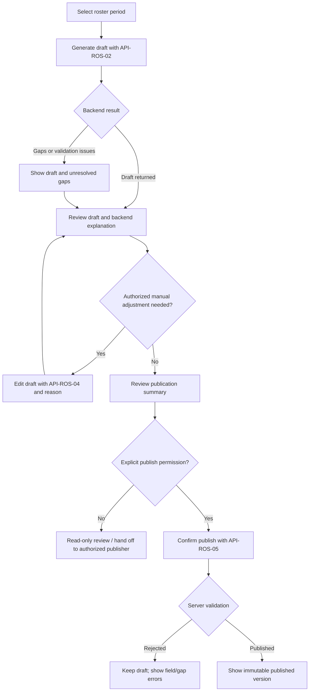

# 08_FRONTEND_ARCHITECTURE_AND_UI_UX_SPECIFICATION.md

## Holiday Support Roster Management System

| Field | Value |
|---|---|
| Document ID | ROSTER-FE-008 |
| Version | 3.0 |
| Status | Finalized frontend integration specification under authorized reconciliation |
| Created / updated | 27 November 2026 |
| Owner | Frontend Architecture |
| Governing business authority | `ROSTER_CONFIRMED_BUSINESS_DECISIONS.md` v1.2 Parts F/G |
| Governing API contract | `07_API_CONTRACT_AND_OPENAPI_SPECIFICATION.md` v3.0 and `openapi.yaml` 3.0.3, version 3.0.0 |
| Intended implementer | Antigravity |

### Revision history

| Version | Date | Change |
|---|---|---|
| 1.0 | 27 Nov 2026 | Initial implementation specification; maps user-facing workflows to the Document 07 contract and preserves unresolved decisions. |
| 1.1 | 27 Nov 2026 | Reconciled all 31 screens to API operationIds; aligned manual assignment to candidate lookup and unfilled-slot assignment operations; corrected inaccurate mappings and documented conditional coverage. |
| 1.2 | 27 Nov 2026 | Reconciled screen response fields and pagination to Document 07/OpenAPI v1.2; retained all unresolved policy and infrastructure conditions. |
| 2.0 | 27 Nov 2026 | Finalized password/account, approval-grant, availability, workload, handover and closed-period revision behavior; mapped new v2.1 operations and removed completion/acknowledgement controls. |
| 2.1 | 27 Nov 2026 | Aligned availability, holiday change history, grant validity, recusal, workload dimensions, and standby activation mappings to API/OpenAPI v2.1 and Database v1.4. |
| 2.2 | 27 Nov 2026 | Synchronized employee name/eligibility/email fields, Team Lead lifecycle and permission, directory limitations, resource scopes and duty-history visibility with PO-01..12 and API/OpenAPI v2.2. |
| 3.0 | 27 Nov 2026 | Moved breaking employee changes to `/api/v2`; specified session CSRF bootstrap, Team Lead appointment/replacement concurrency, scoped visibility and permission presentation; aligned the client to OpenAPI v3.0. |

### Related sources

`ROSTER_PROJECT_MASTER_MEMORY.md` v1.8; `ROSTER_CONFIRMED_BUSINESS_DECISIONS.md` v1.1 Part F; `Roster_Corrected_Final_PRD_v5.md` v5.4; `02_DOMAIN_AND_BUSINESS_RULES.md` v2.3; `03_ROLES_PERMISSIONS_AND_WORKFLOWS.md` v2.3; `04_SYSTEM_ARCHITECTURE.md` v2.4; `05_DATABASE_DESIGN_AND_DATA_DICTIONARY.md` v1.4; `06_BACKEND_TECHNICAL_SPECIFICATION.md` v1.4; Document 07 v3.0; `openapi.yaml` 3.0.0.

## 1. Purpose, authority, and implementation boundary

This document specifies the product-specific browser experience and modular Vanilla JavaScript client. HTML5, CSS3, Vanilla JavaScript ES6+, and ES Modules are mandatory. Antigravity is the development tool, not a runtime framework. Do not add React, a router framework, TypeScript, a client build system, or a backend implementation.

The browser communicates only with the Java/Spring Boot API. It does not access MySQL, determine authoritative fairness, grant permissions, or change an assignment before the backend confirms the operation. Document 07/OpenAPI v3.0 is the shared contract boundary under the recorded FDR and direct Product Owner decisions; this specification maps to that contract and does not add API behavior.

No hosting, repository, deployment, base-URL injection mechanism, or handoff provider is selected here. SETUP-01 remains an external configuration dependency. The API base URL must be supplied by the eventual environment configuration, without embedding a production URL in source.

## 2. Product experience and role model

### 2.1 Experience principles

- Keep the next relevant action visible and explain why an action is unavailable.
- Present roster versions and assignment categories with explicit text labels, dates, and history.
- Explain generation using backend-provided explanations; never calculate or imply an unapproved fairness formula.
- Confirm consequential actions and show the server's resulting state.
- Keep employee information scoped to the current user's effective permissions and resource scope.
- Use the same navigation and interaction patterns across roles, while rendering only authorized destinations.

### 2.2 Role experiences

| Role/capability | Primary responsibility and dashboard | Navigation/data/actions | Restricted behavior and journeys |
|---|---|---|---|
| Admin | Organization operations; calendar, roster lifecycle, organization reporting, audit, help content | Employee/team, holidays, roster, workload, audit, help administration when corresponding permissions exist | Admin is not automatically a Manager approver. Publish, generate, staffing configuration and org reporting remain permission-gated. Common journey: configure holiday → create period → generate → review → publish. |
| Team Lead | Team-scoped coordination and roster context | Team roster, permitted availability, workload, replacement participation, handover; each item requires effective permission and scope | No access to unrelated teams, organization configuration by default, or approval authority by title. Common journey: review team schedule → coordinate availability → follow a replacement request if authorized. |
| Member / Employee | Own upcoming assignment, availability, requests, notifications, and help | Own roster details, own availability, report unavailability, own duty history, handover if enabled | Cannot alter effective assignment or approve own request. Common journey: submit availability → review own schedule → report unavailability against an assignment. |
| Replacement approver capability | Review and decide within an explicit active grant and scope | Replacement inbox/candidate panel only when `REPLACEMENT.APPROVE` is returned; recused users never see decision actions | Not an application role. No Admin/TL receives the capability by inference; grants are managed through `ORG.AUTHORITY.MANAGE`. |

The UI reads effective roles, permissions, scopes, CSRF token, and onboarding state from `getCurrentSession` (`API-AUTH-03`). Role names alone do not authorize actions. Team membership alone is not a permission.

## 3. Information architecture and route policy

### 3.1 Application shell

Unauthenticated routes: `/login`, `/unauthorized`, `/session-expired`. Authenticated shell: compact header (product name, current page, notification entry, help entry, profile/session menu), collapsible primary navigation, main landmark with page title and breadcrumbs on nested detail/edit routes, and a responsive content region. Profile menu shows signed-in identity and role labels returned by the API, with sign out. No unsupported account/password editor is shown. No separate global notification delivery controls are exposed.

Navigation is permission-derived after `getCurrentSession`; deep links repeat the permission/scope check before fetching data. While session state is unknown, render a neutral loading shell and no privileged links. On 401 clear in-memory user data, return to login, and show a session-expired explanation. On 403 show a no-access page without leaking resource existence. A 404 is rendered as unavailable/not visible. Do not treat hidden navigation as security.

### 3.2 Navigation matrix

| Label | Destination / purpose | Visibility rule | Priority | API module |
|---|---|---|---|---|
| Overview | Role-specific actionable landing page | Authenticated session | Primary | Session, roster, availability, notifications (only contract-supported data) |
| My availability | Own records, create, history, permitted withdrawal | `AVAILABILITY.MANAGE_OWN` | Primary for all roles with grant | Availability |
| Roster | Periods and permitted roster views | `ROSTER.READ` | Primary | Roster |
| Holidays | Calendar and per-holiday staffing | `CALENDAR.READ`; edit controls require `CALENDAR.MANAGE` / explicit staffing permission | Primary for calendar operators; secondary otherwise | Holidays |
| Employees and teams | Directory, details, memberships | `ORG.USER.READ`; mutation controls independently require management permissions | Secondary | Organization |
| Replacement requests | Requests and candidate/decision workflow | `REPLACEMENT.READ` for list; request own for submission; candidate/decision actions require explicit grant | Primary when actionable; otherwise contextual link | Replacement |
| Workload and history | One selected workload dimension at a time | Own/team/org scope plus `DUTY.REPORT.READ` where required | Secondary | History |
| Handovers | Operational reports | `HANDOVER.READ` or `HANDOVER.CREATE` | Secondary | Handover |
| Notifications | Own notifications and unread count | `NOTIFICATION.READ` | Header utility | Notifications |
| Help Centre | Search, categories, role-visible articles | `HELP.READ` | Header utility | Help |
| Audit | Append-only event review | `AUDIT.READ` and scope | Admin/authorized auditor only | Audit |

Unavailable modules are omitted from navigation. Onboarding is a resumable overlay/page from `getOnboardingProgress` / `updateOnboardingProgress`; it cannot block urgent work. No standalone duty-completion route or password reset/change route is provided by the API contract.

## 4. Screen inventory and screen-level specifications

### 4.1 Specification conventions

The tables below define every planned screen, stable ID, access, fields, actions, API operations, validation, and states. Common state behavior applies to every screen: initial load uses an inline skeleton with the page heading retained; zero results show a scoped empty message and a permitted next action; errors show a concise message plus retry where safe; success is announced in a status region and persisted server state is reloaded or adopted. Mutations disable their submit control while pending. Responsive behavior uses stacked cards on narrow widths and preserves table semantics where tabular comparison matters. Accessibility is keyboard operation, visible focus, semantic headings/landmarks, associated labels, and announced errors/status.

In API cells, grouped IDs are from Document 07, followed by exact OpenAPI operationIds in parentheses where applicable. A dash means no API-backed screen action is approved; do not invent one.

### 4.2 Authentication, shell, and onboarding

| ID / screen | Roles, permission, entry | Components and displayed data | Actions, API, validation | Loading / empty / error / success; responsive and accessibility |
|---|---|---|---|---|
| AUTH-01 Login | Public; `/login` | Product identification, username/identifier and password fields, inline error region | Bootstrap CSRF with `getCsrfToken`, then sign in → `API-AUTH-01 (login)`. Public authentication POSTs still require `X-CSRF-TOKEN`; token stays in memory. | Pending button state; no empty state; generic credential failure without account enumeration; refresh CSRF after login/session rotation, then route to authorized overview. Narrow single-column form; labels, autocomplete appropriate to credentials, password toggle must be keyboard accessible. |
| AUTH-02 Session expired / logout | Any session; 401 or profile menu | Session-expired explanation, sign-in link; logout confirmation only if needed for unsaved work | Logout → `API-AUTH-02 (logout)`; expiry redirects without logout call if session is already invalid. | Preserve safe return destination only in memory; no stale private data; responsive full-page notice; focus moves to heading. |
| AUTH-03 Unauthorized / unavailable | Authenticated or deep link | No-access/unavailable explanation and safe navigation | Return to overview; no data action | 403/404-safe wording; no resource disclosure; focus heading. |
| ONB-01 First-use walkthrough | Authenticated; onboarding state indicates incomplete | Role-specific steps, progress, current step and completion state | Resume, next/back, skip/restart where supported by progress contract → `API-ONB-01 (getOnboardingProgress, updateOnboardingProgress)` | Persistence errors retain current step and retry; completion confirmation; dismissible and never blocks urgent work. Mobile one-step layout; dialog focus management if modal. Step contents must derive only from confirmed role tasks. |
| APP-01 Role dashboard | All authenticated roles; `/` | Upcoming holidays, own/team permitted roster status, pending actionable requests, notifications, workload summaries only where APIs provide dimensions and scope | Navigate to supported modules; refresh | Data assembled only from contract operations, not unsupported metric endpoints; unavailable data omitted with clear reason, not fabricated. Cards stack on mobile; heading and status labels. |

### 4.3 Organization and calendar

| ID / screen | Roles, permission, entry | Components and displayed data | Actions, API, validation | States; responsive and accessibility |
|---|---|---|---|---|
| ORG-01 Employee directory | Admin/TL/authorized reader; `ORG.USER.READ` | Paginated list: employee identity, status, visible team/context fields returned by API | Filter only by active status and paginate; open detail. No name search. `API-ORG-01 (listEmployees)` | Empty scoped directory; pagination controls expose current page; mobile row cards with labels. |
| ORG-02 Employee detail and duty history | Authorized scope; `ORG.USER.READ`, own detail as allowed | Profile fields and effective status; separate duty-history dimensions | Open edit/membership/role actions only with grant. `API-ORG-02 (getEmployee)`, `API-DUT-01 (getDutyHistory)` | No combined total; protected fields omitted; stale data refresh. Responsive sections; table labels. |
| ORG-03 Create/edit employee | Admin with `ORG.USER.MANAGE` | Validated form: firstName, lastName, unique workEmail, employment dates, and effective rotationEligibleFrom/To; displayName is derived and read-only | Create/update `API-ORG-01 (createEmployee)`, `API-ORG-02 (updateEmployee)`; `If-Match` for update; field errors from 422 | Dirty-form guard; 409 reload/compare; success returns detail. Required/date/status validations align to schema only. |
| ORG-04 Teams, membership and Team Lead history | `ORG.USER.READ` with assigned-TEAM or ORG scope; mutations require their exact organization permission and ORG scope | Scoped team list, effective-dated memberships, Team Lead assignment history, inclusive dates and versions | `API-ORG-03/04` team/membership operations; `API-ORG-08 (listTeamLeadAssignments, assignTeamLead, replaceTeamLead, terminateTeamLeadAssignment, correctTeamLeadAssignmentHistory)`. Appointment/replacement use collection ETag; termination/correction use assignment rowVersion. | Scope controls which teams/history are presented; backend remains authoritative. Team Lead writes require ADMIN plus `ORG.TEAM_LEAD.MANAGE`. Atomic replacement, no overlapping inclusive intervals, role and membership prerequisites. No reason field. Responsive history cards and accessible action forms. |
| ORG-05 Role assignment | Admin with `ORG.ROLE.MANAGE`; read scope for catalogue | Visible role catalogue, current effective assignments | Read/create assignment via `API-ORG-05 (listVisibleRoles, listEmployeeRoleAssignments, createEmployeeRoleAssignment)` | Explicit warning that role assignment does not grant Manager capability; approval grant provisioning is shown only where the effective ORG.AUTHORITY.MANAGE permission is returned. |
| CAL-01 Holiday calendar/list | `CALENDAR.READ` | Date-ordered holidays, status, explicit Primary count and optional Standby count where returned | Open details/create; `API-HOL-01 (listHolidays)` | Empty calendar offers create only with grant. Calendar has accessible list alternative; mobile list-first. |
| CAL-02 Holiday detail/configuration | Reader; edit with `CALENDAR.MANAGE` and requirement permission | Holiday identity/date/status, staffing counts, relevant eligibility context only if API provides it | Create/update `API-HOL-01 (createHoliday)`, `API-HOL-02 (updateHoliday)`; counts are separate nonnegative values; update uses `If-Match` when row-versioned. | Staffing remains per-holiday, never hardcoded. OD-02/OD-11 conditions shown; 409 refresh. Form groups named Primary and Standby. |

### 4.4 Availability and roster

| ID / screen | Roles, permission, entry | Components and displayed data | Actions, API, validation | States; responsive and accessibility |
|---|---|---|---|---|
| AVL-01 My availability and history | Own user with `AVAILABILITY.MANAGE_OWN`; optional scoped reader | Date range, declaration type, timestamps, current record state and change history | `API-AVL-01 (listAvailability, createAvailability)` and `updateAvailability`; date range start ≤ end | Submission/update takes effect immediately for future generation/draft checks; no approval queue. |
| AVL-02 Availability detail/withdraw | Owner or explicit delegated scope | Record details; assignment conflict is handled through replacement request | `API-AVL-02 (withdrawAvailability)`; confirm; no direct assignment removal | 409 refresh; withdrawal is prospective and does not remove published assignment (FDR-05). |
| ROS-01 Period list/create | `ROSTER.READ`; create requires explicit creation permission | Period dates, visible current version/state, version lineage as returned | `API-ROS-01 (listRosterPeriods, createRosterPeriod)`; start ≤ end | Empty state action only with creation grant; date inputs and paginated list accessible. |
| ROS-02 Roster overview | Scoped `ROSTER.READ` | Holiday, slot type, assigned person, assignment origin, version, state, gap, future/draft distinctions | Read `API-ROS-03 (getRoster)`; open generation run and assignment detail | Always show DRAFT / PUBLISHED / HISTORICAL labels in text; future published assignment is planning, not completed duty. Filter only contract-supported fields. |
| ROS-03 Generate draft and result | Explicit `ROSTER.GENERATE` | Period/holiday selection, generation result, staffing gaps, backend fairness explanations and run metadata | Generate `API-ROS-02 (generateRosterDraft)`; inspect `API-ROS-06 (listGenerationRuns)`; idempotency key per command | Confirmation summarizes period and draft-only effect. Pending state blocks duplicate command. Never show invented progress percentage. Infeasible result preserves gaps. |
| ROS-04 Draft review / fairness explanation | Scoped `ROSTER.READ` | Draft watermark/banner, assignments, gaps, approved fairness explanation, run/version provenance | Review; navigate to assignment edit; refresh `API-ROS-03/06` | Draft never resembles official published plan; explain FDR-02 comparison from backend data only. |
| ROS-05 Assignment selection/edit | `ROSTER.MANUAL_ASSIGN` and required scope | Slot, current assignee, eligible and available candidates, reason field | Discover candidates via `API-ROS-07 (listDraftAssignmentCandidates)`; update a known assignment via `API-ROS-04 (updateDraftAssignment)` or fill an unassigned slot via `API-ROS-08 (createDraftAssignment)`; use `If-Match` | Candidate list is advisory, not a reservation. Backend revalidates eligibility, availability, uniqueness, slot and version at write. Generation uses FDR-02; client does not rank. |
| ROS-06 Publish confirmation/result | `ROSTER.PUBLISH` | Version, coverage summary and validation results supplied by API | Publish `API-ROS-05 (publishRosterVersion)` with idempotency key and concurrency token | Confirmation says publication creates official immutable version. If backend rejects, show exact uncovered/validation reasons; success routes to published version. |
| ROS-07 Published roster/history | Scoped `ROSTER.READ`; revision requires `ROSTER.REVISE` | Current/prior versions, parent lineage, reasoned correction workflow | Read `API-ROS-03 (getRoster)`; create `createRosterRevision`; publish via `publishRosterVersion` | Old version remains immutable; a different authorized publisher is required, including for closed periods. |

### 4.5 Replacement, standby, duty history, and handover

| ID / screen | Roles, permission, entry | Components and displayed data | Actions, API, validation | States; responsive and accessibility |
|---|---|---|---|---|
| REP-01 Request unavailability/replacement | Assigned employee; `REPLACEMENT.REQUEST_OWN` | Current published assignment and required reason | `API-REP-01 (createReplacementRequest)`; confirmation states original assignment remains in effect pending decision | Success displays pending request, never claims replacement effective. No eligible candidate leads to visible staffing gap. |
| REP-02 Request list/detail | Request participant or scoped `REPLACEMENT.READ` | Requester, original assignee/slot, status, reason, decision history, gap state | `API-REP-01 (listReplacementRequests)` | Empty scoped inbox; never leak unrelated requests; status text plus icon. |
| REP-03 Candidate review and decision | Explicit active scoped single `REPLACEMENT.APPROVE` permission; FDR-03 recusal applies | Standby first if eligible/available, then alternatives, validation, original assignment and history | Candidate list `API-REP-02 (listReplacementCandidates)`; decide `API-REP-03 (decideReplacement)` | Without grant or when conflicted, no decision controls. Backend revalidates. If no approver exists, pending escalation; no assignment change. |
| STB-01 Standby and activation | Roster reader; activation requires `STANDBY.ACTIVATE` | Standby designation/history, separate from Primary; approved replacement assignment lineage | Activation `API-STB-01 (activateStandby)` | Activation alone never creates workload credit or actual-performer fact. No completion action. |
| DUT-01 Workload and assignment history | Own/team/org scope and `DUTY.REPORT.READ` where required | Seven separate dimensions: effective published Primary credit, future published Primary, Standby assignment, activation, draft, replaced and cancelled assignment | `API-DUT-01 (getDutyHistory)` one requested dimension per response; supported filters only | Never sum unlike dimensions or imply actual completion. Empty state names selected dimension. No completion mutation exists. |
| HO-01 Handover list/detail/create | `HANDOVER.READ`/`HANDOVER.CREATE`; visibility scope | Operational summary/items, author/time, prior report link for addendum | `API-HO-01 (listHandoverReports, createHandoverReport, getHandoverReport)` | Informational only; submitted content immutable; corrections are linked addenda; no acknowledgment/receiver-signoff. Render text, not HTML. |

### 4.6 Notifications, help, audit

| ID / screen | Roles, permission, entry | Components and displayed data | Actions, API, validation | States; responsive and accessibility |
|---|---|---|---|---|
| NOT-01 Notification list/detail | Own `NOTIFICATION.READ` | Message, time, read state, relevant underlying route | `API-NOT-01 (listNotifications, getUnreadNotificationCount)`, `API-NOT-02 (markNotificationRead)` | Read state update announced; deep link still rechecks permission. No secondary channel settings. |
| HELP-01 Help Centre/search/article | `HELP.READ` | Search, categories, role-visible published articles, step guide | `API-HELP-01 (listHelpArticles, getHelpArticle)` | Search uses documented query only; no-result state suggests categories; content treated as untrusted text/approved safe markup. |
| HELP-02 Help content management | Admin with `HELP.MANAGE` | Article/category content and lifecycle fields supported by schema | `API-HELP-01 (createHelpArticle, updateHelpArticle)` | No external CMS. Preview sanitizes content; mutation confirmation and audit outcome. |
| AUD-01 Audit events | `AUDIT.READ` and organization scope | Actor, action, target, time, reason, before/after references and filters returned | `API-AUD-01 (listAuditEvents)` | Read-only append-only view; pagination; narrow screens use labeled event cards. |

**Coverage count:** 31 screen specifications (AUTH 3, ONB 1, APP 1, ORG 5, CAL 2, AVL 2, ROS 7, REP 3, STB 1, DUT 1, HO 1, NOT 1, HELP 2, AUD 1). Conditional or unavailable actions are explicitly marked rather than presented as approved functionality.

## 5. Design system

### 5.1 Tokens

Use CSS custom properties as the sole source for colors, spacing, type, borders and focus rings. These are proposed interface tokens (not a brand approval); verify contrast before implementation.

```css
:root {
  color-scheme: light;
  --color-ink: #172b3a;
  --color-muted: #526776;
  --color-canvas: #f5f8fa;
  --color-surface: #ffffff;
  --color-border: #cbd7df;
  --color-primary: #145b73;
  --color-primary-hover: #10485b;
  --color-focus: #0b67a3;
  --color-success: #176b48;
  --color-warning: #815500;
  --color-danger: #a12d32;
  --color-info: #245d8c;
  --space-1: .25rem; --space-2: .5rem; --space-3: .75rem;
  --space-4: 1rem; --space-6: 1.5rem; --space-8: 2rem;
  --radius-sm: .25rem; --radius-md: .5rem;
  --shadow-panel: 0 1px 3px rgb(23 43 58 / 12%);
  --content-max: 80rem;
}
```

Typography: system sans-serif stack; body 1rem/1.5; small metadata no smaller than .875rem; page title clamp 1.5–2rem; section title 1.25rem; keep line length comfortable. Spacing follows 4px increments. Content uses a fluid 12-column desktop grid, 24px gutters, 16px tablet gutters, and a single-column mobile layout. Borders define tables/forms; use restrained panel shadows; no decorative motion. Icons must have text labels or accessible names and never carry status alone.

### 5.2 Components and status semantics

- Buttons: primary for the page's main action, secondary for safe alternatives, destructive styling for irreversible/critical confirmation. Use native `<button>`; never use clickable `<div>`.
- Inputs/selects: visible labels, helper text, required state and inline field errors linked with `aria-describedby`; native controls unless the native behavior fails a stated requirement.
- Tables: semantic `<table>`, caption, column headers and row actions; use pagination for contract collections. On small screens, convert rows to labeled cards rather than a horizontally clipped table.
- Cards/panels: group one business purpose; no unsupported KPI cards. Badges include visible text and optional icon.
- Modal/dialog: only for consequential confirmation or focused choice; trap focus, Escape closes only before submission, restore focus to trigger. Use a full-height drawer on mobile when content is lengthy.
- Toasts: short noncritical acknowledgement with `role=status`; errors that require action remain inline/alert.
- Alerts: `role=alert` for blocking errors; do not disappear automatically.
- Tabs: only when switching sibling views; keyboard arrow behavior and selected state.
- Empty/loading: skeletons preserve layout; empty state describes scope and next permitted action. Respect reduced-motion settings.
- Pagination: expose page, page size and disabled states; use only documented server pagination.

| Business state | Required treatment |
|---|---|
| Draft | Persistent “Draft — not published” label and neutral/warm outlined banner; watermark where roster resembles a schedule |
| Published | “Published” label plus version/date; calm positive styling, not green-only |
| Pending approval | “Awaiting Manager decision” text and clock icon; no implied approval |
| Approved / rejected | Explicit decision text, actor/time when returned, distinct icon and accessible color |
| Unresolved staffing gap | High-contrast alert with “Unresolved staffing gap,” affected holiday/slot and next permitted action |
| Unavailable | Text state and date range; do not imply assignment removal |
| Standby | “Standby (backup)” label; visually distinct from Primary and excluded from completed-duty indicators |
| Completed duty | “Completed Primary duty” only when supported by actual completion data; no completion action until OD-08 |

No color-only status. Use WCAG 2.2 AA contrast as the target, including focus indicators and status text; verify actual rendered pairs during implementation.

## 6. Frontend architecture

### 6.1 Proposed module layout

```text
frontend/
  index.html
  assets/
    icons/
  css/
    tokens.css
    base.css
    layout.css
    components.css
    pages.css
  js/
    main.js
    app.js
    config.js
    router.js
    state/
      session-store.js
    api/
      client.js
      errors.js
      session.js
      employees.js
      holidays.js
      availability.js
      roster.js
      replacements.js
      history.js
      handover.js
      notifications.js
      help.js
      audit.js
      onboarding.js
    components/
      shell.js
      navigation.js
      form-controls.js
      data-table.js
      status-badge.js
      dialog.js
      alert.js
      pagination.js
    features/
      auth/
      dashboard/
      onboarding/
      organization/
      holidays/
      availability/
      roster/
      replacements/
      standby/
      history/
      handover/
      notifications/
      help/
      audit/
    utils/
      date.js
      dom.js
      format.js
      validation.js
```

This is a logical structure; it does not approve a bundler or package manager. Serve ES modules in the selected environment. If environment injection requires a configuration file, SETUP-01 must select its mechanism; `config.js` reads that value and rejects a missing/invalid base URL with a safe startup message.

### 6.2 Responsibilities and data flow

- `main.js` starts the application; `app.js` loads session state, onboarding progress, then renders the shell and selected route.
- `router.js` maps explicit paths to feature renderers, handles history navigation and disposes the prior view. It is a small application module, not a framework.
- Feature modules own screen state and event handlers. Shared state is limited to session identity/permissions and shell notification count; screens own fetched data and form drafts.
- Components accept data and callbacks, return DOM nodes, and do not fetch implicitly. Use DOM APIs and `textContent` for untrusted values.
- API service modules expose named operations corresponding to OpenAPI operationIds; feature modules do not build endpoint URLs or parse envelopes independently.
- Forms validate required fields and formats before request, disable duplicate submit, send command, map `fieldErrors`, then refresh/adopt the authoritative response. Abort outstanding read requests on route disposal where supported.
- Errors propagate as normalized API errors to screen-level presentation. Do not swallow errors or show raw stack/server internals.
- Register listeners with an `AbortController` or remove them during route cleanup; avoid global event handlers that accumulate on navigation.
- Use native browser modules, semantic HTML, and CSS. No global application store for ordinary fetched lists; no client-side cache of sensitive data beyond the active view.

### 6.3 Route and authorization pattern

Route metadata declares required permission(s) and resource scope expectations. On each route transition: check authenticated session, then effective permission, then fetch scoped resource. For mutation controls, check the specific action permission, not merely module visibility. The backend response remains authoritative; 401 resets session, 403 renders access denial, 404 renders unavailable, 409 refreshes versioned data and asks the user to reapply, 422 maps field/business errors, 429/5xx/503 show retry guidance without resubmitting non-idempotent actions blindly.

## 7. API integration contract

### 7.1 Client behavior

`api/client.js` reads the environment-provided `{baseUrl}` and appends `/api/v2`; `/api/v1` remains the documented legacy contract and is not used by this frontend; credentials use same-origin session cookies (`credentials: "same-origin"` for same-origin deployment). Before any unsafe request, the client obtains a session-backed token from `GET /api/v2/session/csrf`; it sends `X-CSRF-TOKEN` even for unauthenticated login/activation/reset requests. Refresh the token after login, logout, activation, reset and session rotation; keep it in memory only. Use authoritative ETags/rowVersion for `If-Match` and never fabricate a fallback version; appointment/replacement use the team history collection ETag, termination/correction use the assignment rowVersion. Use `Idempotency-Key` for generation, publication, and replacement commands. Do not add JWT/OAuth/refresh-token logic. Do not put secrets in source.

Parse documented JSON envelopes and `204` responses. Normalize errors to `{status, code, message, fieldErrors, correlationId}`. Present safe user-facing messages; preserve correlation ID for support. Unknown response fields may be ignored; unknown failures receive a generic message. Server pagination is zero-based and page size is 1–100, default 25, using only documented filter/sort parameters. Refresh data on return to a stale detail view and after successful mutation.

### 7.2 Screen-to-operation map

| API ID group | OpenAPI operationIds | Screens |
|---|---|---|
| API-AUTH-00..03 | `getCsrfToken`, `login`, `logout`, `getCurrentSession` | AUTH-01..03, APP-01, shell |
| API-ORG-01..08 | employee and team operations; `listTeamLeadAssignments`, `assignTeamLead`, `replaceTeamLead`, `terminateTeamLeadAssignment`, `correctTeamLeadAssignmentHistory` | ORG-01..06 |
| API-HOL-01..02 | `listHolidays`, `createHoliday`, `updateHoliday` | CAL-01..02 |
| API-AVL-01..02 | `listAvailability`, `createAvailability`, `withdrawAvailability` | AVL-01..02 |
| API-ROS-01..08 | `listRosterPeriods`, `createRosterPeriod`, `generateRosterDraft`, `getRoster`, `listGenerationRuns`, `updateDraftAssignment`, `publishRosterVersion`, `listDraftAssignmentCandidates`, `createDraftAssignment` | ROS-01..07 |
| API-REP-01..03 | `listReplacementRequests`, `createReplacementRequest`, `listReplacementCandidates`, `decideReplacement` | REP-01..03 |
| API-STB-01 | `activateStandby` | STB-01 |
| API-DUT-01 | `getDutyHistory` | ORG-02, DUT-01 |
| API-HO-01 | `listHandoverReports`, `createHandoverReport`, `getHandoverReport` | HO-01 |
| API-NOT-01..02 | `listNotifications`, `getUnreadNotificationCount`, `markNotificationRead` | APP-01, NOT-01, shell |
| API-ONB-01 | `getOnboardingProgress`, `updateOnboardingProgress` | ONB-01 |
| API-AUD-01 | `listAuditEvents` | AUD-01 |
| API-HELP-01 | `listHelpArticles`, `createHelpArticle`, `getHelpArticle`, `updateHelpArticle` | HELP-01..02 |

### 7.3 Contract gaps and limits

Document 07/OpenAPI v3.0 includes account lifecycle, scoped approval-grant, published-version revision, and effective Team Lead history operations. Manual candidate lookup and empty-slot assignment are supported by API-ROS-07/08. Dashboard aggregate metrics and employee free-text search are not specified product capabilities. Do not render duty completion or handover acknowledgement controls; both are out of initial release. Replacement candidate visibility and all decisions require the single explicit active scoped `REPLACEMENT.APPROVE` permission; controls are hidden/disabled for recused participants. Duty history is own for Employee, own plus assigned team for Team Lead, organization-wide for Admin, and explicitly granted scope for auditor/operator; the backend filters each request. Unconfigured or unauthenticated accounts see no protected organization data.

## 8. UX workflows

### 8.1 Login and initial load

```mermaid
sequenceDiagram
  actor User
  participant UI as Browser UI
  participant API as Backend API
  User->>UI: Submit credentials
  UI->>API: API-AUTH-01 login
  API-->>UI: Session cookie
  UI->>API: API-AUTH-03 getCurrentSession
  UI->>API: API-ONB-01 getOnboardingProgress
  UI-->>User: Authorized dashboard / resumable onboarding
  API-->>UI: 401 on expired session
  UI-->>User: Clear private view state; show sign-in
```

### 8.2 Employee, holiday, and availability journeys

Employee operator opens directory → `listEmployees` → detail `getEmployee` → authorized create/update or membership/role operation. Validate dates and schema-supported fields; on 409 reload the current record and require an explicit resubmission. Holiday operator lists calendar → creates/edits holiday and separate Primary/Standby staffing counts → backend validation result is shown. Availability user opens own view → lists records → submits date range → receives recorded state; if current assignment conflicts, use the replacement request flow. Do not infer approval or silently remove assignment (OD-03).

### 8.3 Generate, review, manually adjust, publish



Generation is idempotent; show pending state and never imply a percentage. Fairness explanation is server-supplied. Manual edit cannot bypass hard eligibility. Publication is critical and requires a clear confirmation showing scope, draft version, affected period, and known gaps. A successful response is the only signal that the version is official.

### 8.4 Replacement and Manager decision

Assigned employee selects “Report unavailability” on a published assignment → supplies reason → `createReplacementRequest` → UI states original assignment remains effective. Authorized approver opens request → `listReplacementCandidates` shows designated Standby first if eligible/available, otherwise alternatives or staffing gap → approver selects candidate/rejects and confirms → `decideReplacement` revalidates server-side. Success displays decision, actor/time where returned, new lineage and effective status. Rejection leaves original. Missing approval grant is fail-closed. No candidate preserves original and presents unresolved staffing gap. Never show a replacement as effective before successful decision response.

### 8.5 Standby, workload, handover, notification, help

Standby activation is a coverage event; only approved replacement lineage transfers the effective Primary slot credit. Workload user selects one of seven assignment-history dimensions; the UI never claims actual performance. Handover author creates an informational report and can correct it with a linked addendum; no acknowledgement or assignment change is implied. Notification user opens own list, follows a target route only after fresh authorization, and marks read. Help user searches/filter categories and opens role-visible content; Admin edits only with `HELP.MANAGE`.

## 9. Responsive design and accessibility

- Desktop (≥1024 CSS px): persistent collapsible sidebar, wide tables with visible captions, content max width and multi-column forms.
- Tablet (768–1023 CSS px): compact/collapsible navigation, two-column forms where labels remain readable, tables may scroll with a visible scroll cue and sticky first column only if keyboard/screen-reader order remains correct.
- Mobile (<768 CSS px): single-column content, navigation drawer with explicit menu button and `aria-expanded`, table rows become labeled cards, full-width controls, dialogs become full-screen sheets, minimum 44×44 CSS px touch targets, no hover-only actions.
- Layout respects 200% text zoom and reflow; no essential action depends on color, precise pointer, hover, or animation.
- All controls keyboard reachable; logical tab order; visible focus; dialogs trap and restore focus; route changes move focus to page heading; validation focuses or announces the first invalid field.
- Use semantic `header`, `nav`, `main`, `form`, headings, lists, table captions, and button names. Announce asynchronous updates using polite live regions and blocking errors with alert semantics.
- Required fields and errors are described in text, programmatically associated, and not communicated by color alone. Maintain accessible contrast, reduced-motion support, and status text+icon.

Target WCAG 2.2 AA. This is a design target, not a claim of conformance testing.

## 10. Frontend security and critical-action safeguards

- Backend authorization and resource scope are final. Client permission checks only control presentation.
- Render user/API content through `textContent` or vetted safe rendering; do not use `innerHTML` with untrusted data. Do not execute content from help articles or handover fields.
- Validate for usability but repeat all business validation on backend. Do not expose secrets, password values, CSRF tokens in URLs, or sensitive records in persistent browser storage/logs.
- On session expiry clear screen data and abort in-flight reads. Use CSRF protection for mutations and session cookies as specified in Document 07.
- Confirm publication, manual assignment changes, replacement decisions, and standby activation with a summary and explicit action label. Disable repeated submits; use contract idempotency keys where required.
- Preserve the pre-decision assignment on replacement screens; never optimistically update the effective assignment. Show conflict response and refresh versioned state after 409.
- Sanitize server error output; show useful code/message and correlation ID without stack traces or internal paths.
- No direct MySQL access, client-side secrets, unsupported external service integration, or speculative API calls.

## 11. Final decisions and external setup UI conditions

| Decision | Affected screens | Design now | Must remain conditional / not implemented |
|---|---|---|---|
| FDR-03 approver scope and recusal | REP-02/03, route/navigation, session capability | Render only for active scoped approval grants; enforce recusal | Customer must provision named grant accounts and scope. |
| FDR-05 availability | AVL-01/02, generation/publish screens | Submit/update immediately; published assignment remains unchanged | Assignment conflict follows replacement workflow. |
| FDR-02 fairness | ROS-03/04/05, DUT-01 | Display backend comparator explanations and dimensions | No client score/rank/recalculation. |
| FDR-01 duty completion excluded | STB-01, DUT-01, dashboard | Show effective published assignment history | No completion button, evidence, actual performer, correction, or attendance UI. |
| FDR-08 handover | HO-01 | Create/read immutable informational reports/addenda | No acknowledgment or required receiver; default retain with roster/audit. |
| FDR-09/10 published revision | ROS-07 and publish/revision controls | Create reasoned child version; distinct publisher | Requires assigned `ROSTER.REVISE` and `ROSTER.PUBLISH` capabilities. |
| SETUP-01 | Startup/config and integration | Keep base URL environment configurable | Repository/handoff, URL, data, mail/secret and infrastructure provisioning remain external setup. |

The initial-release product-policy decisions are finalized in Register v1.1 Part F. No default staffing counts are inferred; snapshots are preserved with each roster version.

## 12. Traceability matrix

| Requirement/workflow | Source | Role | Screen IDs | API operation(s) | Permission | Frontend module | Status |
|---|---|---|---|---|---|---|---|
| Login/session/onboarding | PRD FR-HELP; Roles WF-01; API §6.1 | All | AUTH-01..03, ONB-01 | `login`, `getCurrentSession`, `logout`, `getOnboardingProgress`, `updateOnboardingProgress` | Authenticated; own onboarding | auth, onboarding | Covered; walkthrough content detail partial |
| Employee/team/role administration | PRD FR-ORG; Roles §5; FDR-07 | Admin; scoped reader | ORG-01..05 | `listEmployees`, `createEmployee`, `getEmployee`, `updateEmployee`, `listTeams`, `createTeam`, membership and role operations | `ORG.*` | organization | Covered; effective-dated single team/lead cardinality |
| Holiday and staffing | PRD FR-HOL; BD-001/002 | Admin/config operator | CAL-01..02 | `listHolidays`, `createHoliday`, `updateHoliday` | `CALENDAR.*`, explicit staffing grant | holidays | Covered; OD-02/11 remain |
| Availability | PRD FR-AVL; BR-AVL; Roles WF-02 | All, own or explicit scope | AVL-01..02 | `listAvailability`, `createAvailability`, `withdrawAvailability` | `AVAILABILITY.*` | availability | Covered with approval lifecycle excluded (OD-03) |
| Period and draft generation | PRD FR-GEN; BD-005..010 | Explicit roster operator | ROS-01, ROS-03 | `listRosterPeriods`, `createRosterPeriod`, `generateRosterDraft`, `listGenerationRuns` | `ROSTER.GENERATE` | roster | Covered; fairness policy remains backend/open OD-06 |
| Draft review and manual assignment | PRD FR-MAN; BD-011 | Authorized operator | ROS-04..05 | `getRoster`, `listDraftAssignmentCandidates`, `updateDraftAssignment`, `createDraftAssignment` | `ROSTER.READ`, `ROSTER.MANUAL_ASSIGN` | roster | Candidate lookup and unfilled-slot assignment covered in API v1.1; fairness comparator is FDR-02 |
| Publication and version history | PRD FR-PUB; FDR-09/10 | Authorized publisher/readers | ROS-06..07 | `publishRosterVersion`, `getRoster`, `createRosterRevision` | `ROSTER.PUBLISH`, `ROSTER.READ`, `ROSTER.REVISE` | roster | Publish/read/revision fully covered; separate initiator/publisher |
| Replacement request and approval | PRD FR-REP; FDR-03 | Assigned member; explicitly granted approver | REP-01..03 | `createReplacementRequest`, `listReplacementRequests`, `listReplacementCandidates`, `decideReplacement` | `REPLACEMENT.*`; scoped grant | replacements | Covered; actual grantee and scope are organization setup |
| Standby designation/activation | PRD FR-STB; BD-012/013/023 | Scoped reader/operator | STB-01 | `activateStandby`, `getRoster` | `STANDBY.ACTIVATE` | standby | Read/activation covered; completion attribution lifecycle partial (OD-08) |
| Seven workload dimensions/history | PRD FR-REP-AN; BD-028 | Own/team/org scoped | DUT-01, ORG-02 | `getDutyHistory` | `DUTY.REPORT.READ` as required | history | Read covered; no completion write |
| Handover | PRD FR-HO; FDR-08 | Assigned/authorized users | HO-01 | `listHandoverReports`, `createHandoverReport`, `getHandoverReport` | `HANDOVER.*` | handover | Covered as immutable information transfer with linked addenda; no acknowledgment |
| Notifications | PRD FR-NOT; BD-029 | All, own | NOT-01, APP-01 | `listNotifications`, `getUnreadNotificationCount`, `markNotificationRead` | `NOTIFICATION.READ` | notifications | Covered; no secondary channel |
| Help Centre | PRD FR-HELP | All; Admin manages | HELP-01..02 | `listHelpArticles`, `getHelpArticle`, `createHelpArticle`, `updateHelpArticle` | `HELP.READ`, `HELP.MANAGE` | help | Covered; content lifecycle bounded by API |
| Audit | PRD FR-AUD; BD-031 | Admin/authorized auditor | AUD-01 | `listAuditEvents` | `AUDIT.READ` | audit | Covered |

### 12.1 Coverage gaps

Document 07/OpenAPI v3.0 covers manual candidate discovery, password/account lifecycle, grants, availability changes and closed-period revision. Only APP-01 aggregate metrics (not a specified requirement) and AVL-02 impact preview (not required) are partial. Duty completion and handover acknowledgment are excluded. No policy decision remains open.

### 12.2 Screen/action reconciliation

| Screen | Screen/action | Existing operation ID(s) | Coverage | Missing behavior | Source | Required action |
|---|---|---|---|---|---|---|
| AUTH-01 | Sign in, change/request/reset password, activate invited account | `login`, `changePassword`, `requestPasswordReset`, `resetPassword`, `activateAccount` | FULLY SUPPORTED | Email delivery depends on configured provider | FDR-13; OpenAPI Password*Input | Use non-enumerating response; enforce password limits; never retain secrets. |
| AUTH-02 | Sign out / expired session | `logout`, `getCurrentSession` | FULLY SUPPORTED | Expiry presentation is client-only | API §3 | Clear in-memory session state on 401. |
| AUTH-03 | No-access / unavailable page | None | NOT REQUIRED | No data operation; 403/404 are existing standard responses | API §4 | Render safe state and return link. |
| ONB-01 | Read/save progress and render role walkthrough | `getOnboardingProgress`, `updateOnboardingProgress` | FULLY SUPPORTED | None for reading published role-matched walkthrough content and saving own progress; content must be authored/published | PRD FR-HELP; DB §§8.37–8.39 | Use returned published content and role-matched progress; authoring/seed content is an operational prerequisite, not a new API. |
| APP-01 | Role dashboard and summary cards | `getCurrentSession`, `getRoster`, `listReplacementRequests`, `listNotifications`, `getDutyHistory` | PARTIALLY SUPPORTED | No dashboard aggregate operation; pending counts/summary must be derived only from scoped supported responses | PRD role journeys; Document 07 §6 | Omit unsupported metrics; use existing screen APIs. |
| ORG-01 | Employee listing/search/paging | `listEmployees` | FULLY SUPPORTED | Search not currently documented as a query; active/page/pageSize filters exist | PRD FR-ORG | Use documented filters only; avoid implying free-text server search. |
| ORG-02 | Employee detail and duty history | `getEmployee`, `getDutyHistory` | FULLY SUPPORTED | None for employeeId-scoped reads and separate duty dimensions | PRD FR-ORG; FR-REP-AN | Keep scopes enforced server-side. |
| ORG-03 | Create/update employee; invite and manage linked account | `createEmployee`, `updateEmployee`, `inviteEmployeeAccount`, `activateAccount`, `setEmployeeAccountStatus` | FULLY SUPPORTED | Invitation email requires configured provider | FDR-13; OpenAPI Account* | Keep employee and account states explicit; deactivation revokes sessions. |
| ORG-04 | Teams and per-employee membership | `listTeams`, `createTeam`, `listEmployeeTeamMemberships`, `createEmployeeTeamMembership` | FULLY SUPPORTED | No team-centric membership listing; current screen flow is via employee details | PRD FR-ORG; DB §§8.9–8.11 | Keep membership management per employee unless team-centric view is separately specified. |
| ORG-05 | Role assignment and scoped approval-grant administration | `listVisibleRoles`, `listEmployeeRoleAssignments`, `createEmployeeRoleAssignment`, `listApprovalGrants`, `createApprovalGrant`, `revokeApprovalGrant` | FULLY SUPPORTED | Named grant recipients/scopes are customer setup values | FDR-03; OpenAPI ApprovalGrant | Retain three roles; prohibit self-grant; scope and expiry required. |
| CAL-01 | Holiday list/calendar | `listHolidays` | FULLY SUPPORTED | Calendar rendering can use a list alternative; no separate calendar API required | PRD FR-HOL | Render list/calendar from returned records. |
| CAL-02 | Holiday create/edit/staffing counts and post-publish change request | `createHoliday`, `updateHoliday`, `createRosterRevision` | FULLY SUPPORTED | None; date/staffing/cancellation changes after publish create revision | FDR-04, FDR-09/10 | Require explicit Primary ≥1, Standby ≥0; reject impossible pool counts; preserve identity/history. |
| AVL-01 | Submit/update/list own availability | `listAvailability`, `createAvailability`, `updateAvailability` | FULLY SUPPORTED | Assignment-specific conflict must use replacement request | FDR-05 | Effective immediately; generation and publication revalidate current availability. |
| AVL-02 | Inspect/withdraw availability | `listAvailability`, `withdrawAvailability` | PARTIALLY SUPPORTED | No dedicated get-by-id operation or assignment-impact response | PRD FR-AVL; BR-AVL-003 | Retrieve via scoped list; do not infer effect on assignment; use replacement request path where applicable. |
| ROS-01 | List/create roster period | `listRosterPeriods`, `createRosterPeriod` | FULLY SUPPORTED | None for stated actions | PRD FR-PUB; API-ROS-01 | Validate range in client and server. |
| ROS-02 | Roster overview including vacancies | `getRoster` | FULLY SUPPORTED | v1.1 adds `slots` so vacancy is represented by null `assignmentId` | PRD FR-GEN-12; DB §§8.21–8.23 | Use version snapshot slots; do not infer from current holiday settings. |
| ROS-03 | Generate draft and show result/run | `generateRosterDraft`, `listGenerationRuns` | FULLY SUPPORTED | No live progress stream; generation response is result-based | PRD FR-GEN-01..12; OD-06 | Do not display invented progress percentage or client fairness score. |
| ROS-04 | Review draft and explanation | `getRoster`, `listGenerationRuns` | FULLY SUPPORTED | None for approved FDR-02 comparison/explanation | PRD FR-GEN-10/12; FDR-02 | Present backend explanation verbatim/faithfully; no client calculation. |
| ROS-05 | Find candidates, edit assignment, fill empty slot | `listDraftAssignmentCandidates`, `updateDraftAssignment`, `createDraftAssignment` | FULLY SUPPORTED | No fairness ranking/score | PRD FR-MAN; BD-011; DB §§8.22–8.23 | Use API-ROS-07/08 from v1.1; write operation revalidates. |
| ROS-06 | Publish reviewed version | `publishRosterVersion` | FULLY SUPPORTED | None for authorized publication; validation errors are server returned | PRD FR-PUB-04; BD-021 | Confirm and show success only after 200 response. |
| ROS-07 | Read version lineage / create a reasoned revision | `getRoster`, `createRosterRevision`, `publishRosterVersion` | FULLY SUPPORTED | Separate revision initiator and publisher required | FDR-09/10 | New draft child even for closed period; immutable old versions; distinct publisher. |
| REP-01 | Submit unavailability/replacement request | `createReplacementRequest` | FULLY SUPPORTED | None for creating a request; original remains effective | PRD FR-REP; BD-014/015 | Show pending request only after response. |
| REP-02 | List/detail request and decision history | `listReplacementRequests` | FULLY SUPPORTED | None for request reason, status/timestamps and decision history; identity display labels can be resolved through permitted employee/session data | PRD FR-REP; DB §§8.24–8.25 | Render returned decision history; retain participant/scope authorization. |
| REP-03 | Discover candidates and approve/reject | `listReplacementCandidates`, `decideReplacement` | FULLY SUPPORTED | If no unconflicted active approver, request stays pending and escalates | FDR-03 | Hide decision actions from requester, affected assignee and candidates; enforce scope server-side. |
| STB-01 | View Standby and record approved replacement activation | `getRoster`, `activateStandby` | FULLY SUPPORTED | Activation means assignment history transfer only; it does not assert who performed work | FDR-01/03 | Use replacement approval flow before effective assignment changes; never record actual completion. |
| DUT-01 | Read effective published Primary workload dimensions | `getDutyHistory` | FULLY SUPPORTED | No actual duty completion dimension exists | FDR-01 | Show current effective assignee credits, drafts/Standby separately; no completion control. |
| HO-01 | Create/list/detail immutable handover and linked addendum | `createHandoverReport`, `listHandoverReports`, `getHandoverReport` | FULLY SUPPORTED | No acknowledgement or required recipient | FDR-08 | Submitted report is immutable; correction is a linked new addendum; retain with roster/audit history. |
| NOT-01 | List/detail/read own notification | `listNotifications`, `getUnreadNotificationCount`, `markNotificationRead` | FULLY SUPPORTED | No separate detail operation; list item includes message, target and read timestamps | PRD FR-NOT; DB §§8.32–8.33 | Use authorized target route and own-recipient read state; no external channel controls. |
| HELP-01 | Search/category/article reading | `listHelpArticles`, `getHelpArticle` | FULLY SUPPORTED | None for category filter and role-visible article metadata | PRD FR-HELP; DB §§8.34–8.36 | Use only published content visible to the authenticated role. |
| HELP-02 | Create/update help content | `createHelpArticle`, `updateHelpArticle` | FULLY SUPPORTED | None for category and role visibility fields | PRD FR-HELP; DB §§8.34–8.36 | Preserve Admin permission, content lifecycle, and safe rendering. |
| AUD-01 | Read audit history/details | `listAuditEvents` | FULLY SUPPORTED | None for actor identity, reason, before/after references and event time | BD-031; PRD FR-AUD; DB §8.31 | Keep append-only history scoped and read-only. |

**Classification totals (primary action per screen):** 28 FULLY SUPPORTED, 2 PARTIALLY SUPPORTED, 0 CONDITIONAL, 1 NOT REQUIRED, 0 MISSING API, 0 EXCLUDED. Partial rows are APP-01 (aggregate metrics not approved) and AVL-02 (impact preview is not required); AUTH-03 is NOT REQUIRED because it is a local safe-state view. Password, grant, replacement and revision functionality are covered by API v3.0 operations. No screen adds completion, acknowledgment, mutual swap or other excluded feature.

## 13. Design-level validation

| Check | Result |
|---|---|
| Approved frontend stack preserved | PASS — HTML/CSS/Vanilla JS ES modules only; no framework/build system is prescribed. |
| Roles and permissions consistent | PASS — Admin, Team Lead, Member; explicit scoped approver capability with recusal and no implicit role grant. |
| API operation IDs | PASS — operationIds map to OpenAPI 3.0.0; YAML and reference validation results are in final report. |
| No unsupported endpoint introduced | PASS — new operations implement finalized account, scoped grant and published revision behavior; excluded flows have no endpoint. |
| Draft/published distinction | PASS — persistent labels, confirmation, immutable history and no optimistic publication. |
| Standby workload | PASS — backup/activation separate from effective published Primary credit; no completion data. |
| Replacement approval | PASS — effective change only after explicit Manager decision and server response. |
| Open decisions | PASS — product-policy ODs finalized in decision register; only actual environment/data provisioning remains external. |
| Scope exclusions | PASS — no leave, attendance, payroll, ticket operations, mutual swap, or Comp-Off. |
| Responsive/accessibility | DESIGN COVERED — target WCAG 2.2 AA and responsive behavior specified; no implementation conformance test claimed. |
| API coverage | PASS — 28 full, 2 partial, 1 not required across 31 screen actions; no missing API. |
| Browser or implementation testing | NOT PERFORMED — this is a design specification. |

## 14. Final readiness status

This document is synchronized to the Product Owner's authorized decisions and recorded FDRs. Screen actions map in §12.2 to OpenAPI v3.0. Account/password, approval-grant, and roster revision controls are included. Completion and handover acknowledgment controls are excluded. A screen row's conditional status is limited to unavailable customer setup or permissions, not an unresolved business policy. Dashboard aggregate metrics are not required and remain omitted. Frontend implementation may begin against this baseline; integrated execution still requires the external repository/handoff and environment configuration recorded in Document 11.
